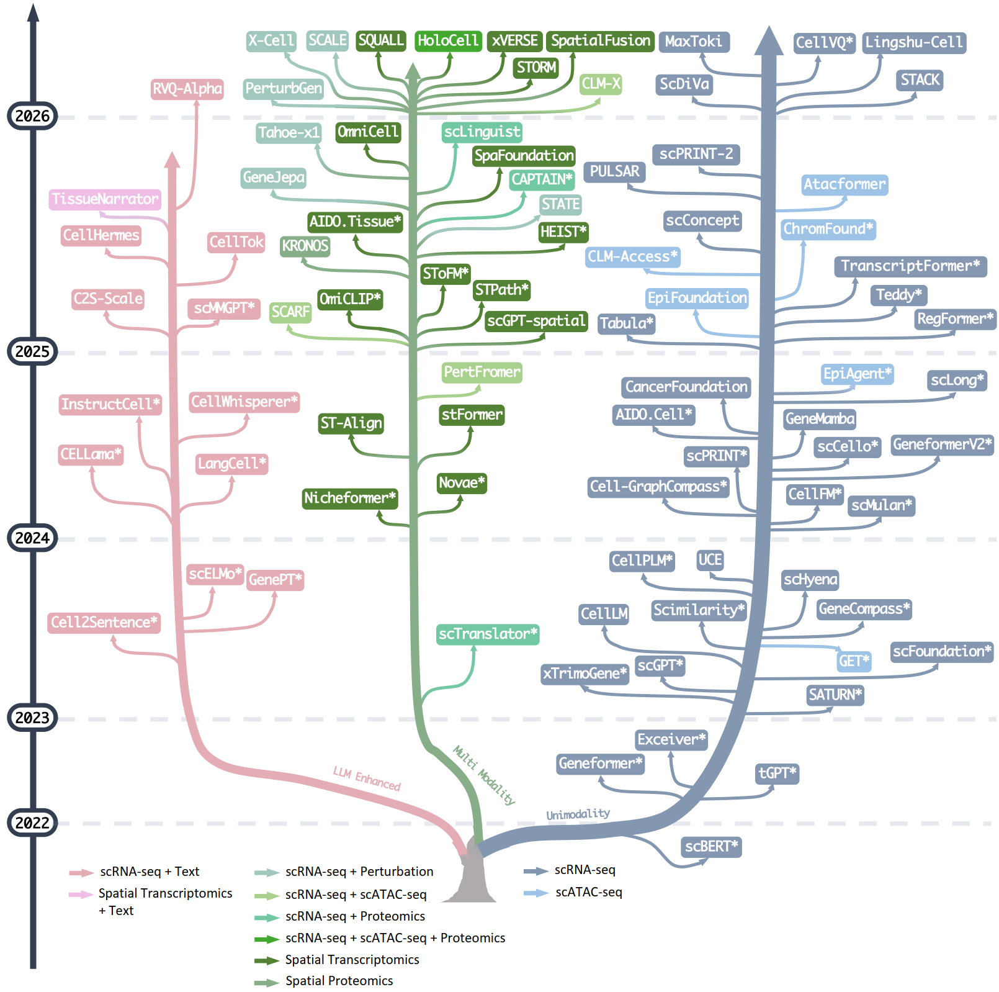

<h1 align="center">Awesome Foundation Models for Single-Cell</h1>

<p align="center">
	<a href="https://awesome.re"></a>
	<a href="http://makeapullrequest.com"></a>
	<a href="https://github.com/OmicsML/awesome-foundation-model-single-cell-papers/stargazers"></a>
	<a href="https://github.com/OmicsML/awesome-foundation-model-single-cell-papers/commits/main"></a>
</p>

<p align="center">
A curated, continuously updated reading list of <b>foundation-model</b> research for <b>single-cell genomics</b>. The structure follows our review <b><i>"The landscape of single-cell foundation models: design principles, applications, and open challenges"</i></b>: single-cell foundation models are organized into <b>unimodal</b>, <b>multimodal</b>, and <b>LLM-based</b> scFMs, and the surrounding literature is grouped into perturbation modeling, virtual cells, pretraining datasets, benchmarks, infrastructure & agents, and surveys.
</p>

<p align="center">
Contributions are very welcome! Found a paper we missed, or a broken link? Open an issue or a pull request.
</p>

<p align="center">
  Evolutionary tree credit: <a href="https://github.com/Mooler0410/LLMsPracticalGuide/tree/main">Mooler0410/LLMsPracticalGuide</a>
</p>

<p align="center">
  <a href="figs/evo_tree.pdf"></a>
</p>

## Citation

Please feel free to cite our comprehensive review on single-cell foundation models, currently **under review at [Cell](https://www.cell.com/cell/home)**:

```bibtex
@article{jiang2026landscape,
  title={The Landscape of Single-Cell Foundation Models: Design Principles, Applications, and Open Challenges},
  author={Jiang, Shiyu and Fang, Zhaoyu and Zhang, Yujie and Zhang, Xuting and Kalfon, J{\'e}r{\'e}mie and Wang, Weixu and Fu, Xi and Patel, Aakash and Rizvi, Syed and Lu, Yuancheng Ryan and others},
  year={2026},
  publisher={Preprints}
}
```

## Catalog
- [Catalog](#catalog)
- [Single-Cell Foundation Models](#single-cell-foundation-models)
  - [Unimodal scFMs](#unimodal-scfms)
    - [scRNA-seq](#scrna-seq)
    - [scATAC-seq](#scatac-seq)
  - [Multimodal scFMs](#multimodal-scfms)
    - [Transcriptomics and Perturbation](#transcriptomics-and-perturbation)
    - [Spatial, Proteomics and Histology](#spatial-proteomics-and-histology)
    - [Multi-omics: RNA, ATAC and Protein](#multi-omics-rna-atac-and-protein)
  - [LLM-based scFMs](#llm-based-scfms)
  - [Applications and biological discovery](#applications-and-biological-discovery)
- [Genetic Perturbation: Models, Atlases and Benchmarks](#genetic-perturbation-models-atlases-and-benchmarks)
  - [Models and prediction frameworks](#models-and-prediction-frameworks)
  - [Perturbation atlases and datasets](#perturbation-atlases-and-datasets)
  - [Perturbation benchmarks](#perturbation-benchmarks)
- [Virtual Cell, World Models and Digital Human](#virtual-cell-world-models-and-digital-human)
  - [Reviews, comments, and perspectives](#reviews-comments-and-perspectives)
  - [Models and frameworks](#models-and-frameworks)
- [Pretraining Datasets and Resources](#pretraining-datasets-and-resources)
  - [Single-cell transcriptomic atlases and repositories](#single-cell-transcriptomic-atlases-and-repositories)
  - [Multimodal and spatial pretraining corpora](#multimodal-and-spatial-pretraining-corpora)
  - [Data formats and frameworks](#data-formats-and-frameworks)
- [Benchmarks and Evaluation](#benchmarks-and-evaluation)
  - [Benchmarks and critical evaluations](#benchmarks-and-critical-evaluations)
  - [Data privacy and accessibility](#data-privacy-and-accessibility)
- [Infrastructure, Platforms and AI Agents](#infrastructure-platforms-and-ai-agents)
  - [Infrastructure and platforms](#infrastructure-and-platforms)
  - [AI agents for single-cell discovery](#ai-agents-for-single-cell-discovery)
  - [Benchmarks for AI agents](#benchmarks-for-ai-agents)
  - [Lab-in-the-loop and active discovery](#lab-in-the-loop-and-active-discovery)
- [Surveys and Perspectives](#surveys-and-perspectives)
- [Foundation Models for Pathology (related work)](#foundation-models-for-pathology-related-work)
- [Foundation Models for Bulk Transcriptomes (related work)](#foundation-models-for-bulk-transcriptome)

## Single-Cell Foundation Models

Single-cell foundation models are pretrained on large-scale atlases to learn transferable representations of cellular state. Following the review, they are grouped by the modalities they are pretrained on: **unimodal** (a single omic), **multimodal** (jointly modeling transcriptomic, epigenomic, proteomic and/or spatial measurements), and **LLM-based** (incorporating large language models or textual biological knowledge).

### Unimodal scFMs

Models trained within a single omic modality (scRNA-seq or scATAC-seq), learning representations through masked reconstruction, autoregressive generation, contrastive/relational alignment, or supervised prediction.

#### scRNA-seq
1. [2026 Nature Communications] **scMomer: a pretraining framework for inferring robust cellular representations from single-cell transcriptomes** [[paper]](https://www.nature.com/articles/s41467-026-78811-3)
1. [2026 NeurIPS] **scOntoFM: Learning Biological Hierarchies in Single-Cell Foundation Models** [[paper]](https://arxiv.org/abs/2611.10838)
1. [2026 Genome Biology] **CellPatch: a flexible and efficient framework for single-cell foundation models empowered by heuristic gene patching** [[paper]](https://link.springer.com/article/10.1186/s13059-026-04329-y)
1. [2026 NeurIPS] **CellMSA: Context Modeling for Single-Cell Representation Learning** [[paper]](https://arxiv.org/abs/2609.38908)
1. [2026 NeurIPS] **LeCellModel: Interpretable Density Estimation over the Gene Expression Manifold** [[paper]](https://neurips.cc/virtual/2026/poster/153391)
1. [2026 NeurIPS] **When Transcriptomic Foundation Models Scale: Domain-Focused Pretraining for Drug Development in Immunology and Inflammation** [[paper]](https://neurips.cc/virtual/2026/poster/149652)
1. [2026 Briefings in Bioinformatics] **Gene-Chronos: parameter-efficient developmental time inference using a pretrained single-cell foundation model** [[paper]](https://academic.oup.com/bib/article/doi/10.1093/bib/bbag469/8785967)
1. [2026 Science Advances] **scProtoTransformer: Scalable reference mapping across molecules, cells, and donors** [[paper]](https://www.science.org/doi/10.1126/sciadv.aef0286)
1. [2026 Nature Communications] **Unify learns cellular evolution with universal multimodal embeddings** [[paper]](https://www.nature.com/articles/s41467-026-76230-y)
1. [2026 PLOS Computational Biology] **GFCAB: Assessing scale and predictive diversity in models for single-cell transcriptomics based on Geneformer** [[paper]](https://doi.org/10.1371/journal.pcbi.1013701)
1. [2026 Synthetic and Systems Biotechnology] **scYeast: a biological-knowledge-guided foundation model on yeast single-cell transcriptomics** [[paper]](https://doi.org/10.1016/j.synbio.2026.05.014)
1. [2026 Briefings in Bioinformatics] **scGenoByte: a GenoByte embedding transformer with biological priors for cell type annotation** [[paper]](https://doi.org/10.1093/bib/bbag369)
1. [2026 Nucleic Acids Research] **scDifformer: diffusion-based post-training for virtual cell modeling across large-scale single-cell data** [[paper]](https://doi.org/10.1093/nar/gkag706)
1. [2026 PNAS Nexus] **Zebraformer: A transformer-based language model reveals developmental constraint and network complexity during zebrafish embryogenesis** [[paper]](https://doi.org/10.1093/pnasnexus/pgag223)
1. [2026 BMC Bioinformatics] **Tissueformer: extending single-cell foundation models to predict population-level phenotypes** [[paper]](https://link.springer.com/article/10.1186/s12859-026-06490-4)
1. [2026 NeurIPS] **TxFM: Effective Biological Representation Learning by Masking Gene Expression** [[paper]](https://arxiv.org/abs/2605.31562)
1. [2026 IEEE Journal of Biomedical and Health Informatics] **MambaCell: A Self-Supervised Mamba Framework for Multi-Task Cell Representation Learning** [[paper]](https://doi.org/10.1109/jbhi.2026.3697580)
1. [2026 Cell Systems] **PaSCient: Learning multi-cellular representations of single-cell transcriptomics data enables characterization of patient-level disease states** [[paper]](https://doi.org/10.1016/j.cels.2026.101570)
1. [2026 ICLR] **SAVE: A Generalizable Framework for Multi-Condition Single-Cell Generation with Gene Block Attention** [[paper]](https://openreview.net/forum?id=l7QEoK4uDP)
1. [2026 AAAI] **PanFoMa: A Lightweight Foundation Model and Benchmark for Pan-Cancer** [[paper]](https://ojs.aaai.org/index.php/AAAI/article/view/37008)
1. [2026 AAAI] **Gene Incremental Learning for Single-Cell Transcriptomics** [[paper]](https://ojs.aaai.org/index.php/AAAI/article/view/37062)
1. [2026 Genome Biology] **scDMC: Unlocking biological insight from single-cell data with an interpretable dual-stream foundation model** [[paper]](https://link.springer.com/article/10.1186/s13059-026-04193-w)
1. [2026 Nature] **Universal cell embedding provides a foundation model for cell biology** [[paper]](https://www.nature.com/articles/s41586-026-10689-z)
1. [2026 Nature Communications] **CellVQ: Illuminating cell states by a comprehensive and interpretable single cell foundation model** [[paper]](https://www.nature.com/articles/s41467-026-70071-5)
1. [2026 ICML] **ScDiVa: Masked Discrete Diffusion for Joint Modeling of Single-Cell Identity and Expression** [[paper]](https://openreview.net/forum?id=Sm7NhztxlA)
1. [2026 Nature Communications] **scLong: A Billion-Parameter Foundation Model for Capturing Long-Range Gene Context in Single-Cell Transcriptomics** [[paper]](https://www.nature.com/articles/s41467-026-69102-y)
1. [2026 Nature Communications] **RegFormer: a single-cell foundation model powered by gene regulatory hierarchies** [[paper]](https://www.nature.com/articles/s41467-026-72198-x)
1. [2026 Nature Computational Science] **GeneformerV2: Scaling and quantization of a large-scale foundation model enables resource-efficient predictions in network biology** [[paper]](https://www.nature.com/articles/s43588-026-00972-4)
1. [2026 ICML] **Scalable Single-Cell Gene Expression Generation with Latent Diffusion Models** [[paper]](https://arxiv.org/abs/2511.02986)
1. [2026 Machine Learning: Health] **Towards foundation models that learn across biological scales** [[paper]](https://doi.org/10.1088/3049-477X/aea764)
1. [2026 IJCNN] **GeneMamba: Efficient and Effective Foundation Model on Single Cell Data** [[paper]](https://doi.org/10.1109/IJCNN69854.2026.11728763)
1. [2026 Advanced Science] **CellPolaris: Transfer Learning for Gene Regulatory Network Construction to Guide Cell State Transitions** [[paper]](https://advanced.onlinelibrary.wiley.com/doi/10.1002/advs.202508697)
1. [2025 Nature Machine Intelligence] **Harnessing the power of single-cell large language models with parameter-efficient fine-tuning using scPEFT** [[paper]](https://www.nature.com/articles/s42256-025-01170-z)
1. [2025 Nature Methods] **scNET: learning context-specific gene and cell embeddings by integrating single-cell gene expression data with protein–protein interactions** [[paper]](https://www.nature.com/articles/s41592-025-02627-0)
1. [2025 Science] **TranscriptFormer: A Cross-Species Generative Cell Atlas Across 1.5 Billion Years of Evolution** [[paper]](https://www.science.org/doi/10.1126/science.aec8514)
1. [2025 NeurIPS] **Tabula: A Tabular Self-Supervised Foundation Model for Single-Cell Transcriptomics** [[paper]](https://openreview.net/forum?id=Vk2sfKAdeu)
1. [2025 Nature Communications] **scPRINT: pre-training on 50 million cells allows robust gene network predictions** [[paper]](https://www.nature.com/articles/s41467-025-58699-1)
1. [2025 Nature Communications] **CellFM: a large-scale foundation model pre-trained on transcriptomics of 100 million human cells** [[paper]](https://www.nature.com/articles/s41467-025-59926-5)
1. [2025 National Science Review] **Cell-GraphCompass: Modeling Single Cells with Graph Structure Foundation Model** [[paper]](https://academic.oup.com/nsr/article/12/10/nwaf255/8172492)
1. [2025 Nature] **SCimilarity: A cell atlas foundation model for scalable search of similar human cells** [[paper]](https://www.nature.com/articles/s41586-024-08411-y)
1. [2025 Nature Genetics] **NicheCompass: Quantitative characterization of cell niches in spatially resolved omics data** [[paper]](https://www.nature.com/articles/s41588-025-02120-6)
1. [2024 NeurIPS] **scCello: Cell-ontology guided transcriptome foundation model** [[paper]](https://neurips.cc/virtual/2024/poster/94537)
1. [2024 RECOMB] **scMulan: a multitask generative pre-trained language model for single-cell analysis** [[paper]](https://link.springer.com/chapter/10.1007/978-1-0716-3989-4_57)
1. [2024 Nature Methods] **scGPT: toward building a foundation model for single-cell multi-omics using generative AI** [[paper]](https://www.nature.com/articles/s41592-024-02201-0)
1. [2024 Nature Methods] **scFoundation: Large Scale Foundation Model on Single-cell Transcriptomics** [[paper]](https://www.nature.com/articles/s41592-024-02305-7)
1. [2024 Nature Methods] **SATURN: Toward universal cell embeddings — integrating single-cell RNA-seq datasets across species** [[paper]](https://www.nature.com/articles/s41592-024-02191-z)
1. [2024 Nature Methods] **scPROTEIN: a versatile deep graph contrastive learning framework for single-cell proteomics embedding** [[paper]](https://www.nature.com/articles/s41592-024-02214-9)
1. [2024 Cell Research] **GeneCompass: Deciphering Universal Gene Regulatory Mechanisms with Knowledge-Informed Cross-Species Foundation Model** [[paper]](https://www.nature.com/articles/s41422-024-01034-y)
1. [2024 Advanced Science] **scmFormer Integrates Large-Scale Single-Cell Proteomics and Transcriptomics Data by Multi-Task Transformer** [[paper]](https://advanced.onlinelibrary.wiley.com/doi/10.1002/advs.202307835)
1. [2024 ICLR] **CellPLM: Pre-training of Cell Language Model Beyond Single Cells** [[paper]](https://openreview.net/forum?id=BKXvPDekud)
1. [2024 Cell Reports Medicine] **cyMAE: Cytometry masked autoencoder: An accurate and interpretable automated immunophenotyper** [[paper]](https://doi.org/10.1016/j.xcrm.2024.101808)
1. [2023 Nature] **Geneformer: Transfer learning enables predictions in network biology** [[paper]](https://www.nature.com/articles/s41586-023-06139-9)
1. [2023 NeurIPS] **xTrimoGene: An Efficient and Scalable Representation Learner for Single-Cell RNA-Seq Data** [[paper]](https://openreview.net/forum?id=gdwcoBCMVi)
1. [2023 iScience] **tGPT: Generative pretraining from large-scale transcriptomes for single-cell deciphering** [[paper]](https://www.cell.com/iscience/fulltext/S2589-0042(23)00613-2)
1. [2023 Nature Methods] **scPoli: Population-level integration of single-cell datasets enables multi-scale analysis across samples** [[paper]](https://www.nature.com/articles/s41592-023-02035-2)
1. [2023 NeurIPS] **MuSe-GNN: Learning Unified Gene Representation From Multimodal Biological Graph Data** [[paper]](https://openreview.net/forum?id=4UCktT9XZx)
1. [2022 Nature Machine Intelligence] **scBERT as a large-scale pretrained deep language model for cell type annotation of single-cell RNA-seq data** [[paper]](https://www.nature.com/articles/s42256-022-00534-z)
1. [2022 Bioinformatics] **scPretrain: multi-task self-supervised learning for cell-type classification** [[paper]](https://academic.oup.com/bioinformatics/article/38/6/1607/6499287)

<details>
<summary>Preprints and workshop papers (41)</summary>

1. [2026 bioRxiv] **Learning gene co-regulation across cells with Multicellular Transformer** [[paper]](https://www.biorxiv.org/content/10.64898/2026.11.14.766251v1)
1. [2026 bioRxiv] **scRM: A single-cell foundation model trained on scRNA-seq reads** [[paper]](https://www.biorxiv.org/content/10.64898/2026.10.24.761590v1)
1. [2026 arXiv] **scTAT: Rethinking One Gene, One Token: Transcriptome-Aware Tokenization for Single-Cell Foundation Models** [[paper]](https://arxiv.org/abs/2611.05410)
1. [2026 arXiv] **Panoramic modelling of single-cell transcriptomes at scale with CellNet** [[paper]](https://arxiv.org/abs/2610.21943)
1. [2026 bioRxiv] **BioMod: Biological Module Tokenization for Single-Cell Foundation Modeling** [[paper]](https://www.biorxiv.org/content/10.64898/2026.10.12.758490v1)
1. [2026 NeurIPS Workshop] **CellVELA: Contextualizing Cell Foundation Models and LLMs via Retrieved Experimental Evidence** [[paper]](https://openreview.net/forum?id=lniT5tQVQi)
1. [2026 NeurIPS Workshop] **Evaluating scConceptX, a Multi-Species Transcriptomics Foundation Model, by Agentic Rediscovery of Known Biology** [[paper]](https://openreview.net/forum?id=uC18JJrgK1)
1. [2026 arXiv] **scTrilemma: Balancing Identity, Invariance, and Fidelity in Single-Cell Representation Learning** [[paper]](https://arxiv.org/abs/2609.38840)
1. [2026 bioRxiv] **LucaCell: a sequence-centric foundation model for cross-species single-cell analysis** [[paper]](https://www.biorxiv.org/content/10.64898/2026.09.08.750024v1)
1. [2026 Research Square] **UniGeneX: Generative atlasing in universal gene expression space defines cell types and microenvironment spectra during disease progression** [[paper]](https://www.researchsquare.com/article/rs-10838361/v1)
1. [2026 bioRxiv] **scMaize: A Single-Cell Foundation Model and Integrated Atlas for Maize** [[paper]](https://www.biorxiv.org/content/10.64898/2026.08.01.742180v1)
1. [2026 arXiv] **Scaling an Autoregressive Transformer for Single-Cell Generation** [[paper]](https://arxiv.org/abs/2608.02961)
1. [2026 arXiv] **Beyond Gene Reconstruction: Learning Cell Representations through Complementary Transcriptomic Views** [[paper]](https://arxiv.org/abs/2608.00985)
1. [2026 bioRxiv] **gANCHOR: CAR T cell foundation model predicts immunotherapy response** [[paper]](https://www.biorxiv.org/content/10.64898/2026.07.11.737994v1)
1. [2026 bioRxiv] **Raw-count embeddings improve single-cell foundation models** [[paper]](https://www.biorxiv.org/content/10.64898/2026.06.29.735389v1)
1. [2026 arXiv] **CellRefine: Prototype Guided Post-pretraining for Single-Cell Representation Learning** [[paper]](https://arxiv.org/abs/2605.07938)
1. [2026 arXiv] **Better Models, Faster Training: Sigmoid Attention for single-cell Foundation Models** [[paper]](https://arxiv.org/abs/2604.27124)
1. [2026 ICLR Workshop] **Trajectory-conditioned reconstruction of single-cell expression suggests regulatory programs** [[paper]](https://openreview.net/forum?id=Lm97gfGfG1)
1. [2026 ICLR Workshop] **GREmLN: A Cellular Graph Structure Aware Transcriptomics Foundation Model** [[paper]](https://openreview.net/forum?id=Q5z9IWwbap)
1. [2026 ICLR Workshop] **Simultaneous Learning from Bulk and Single-Cell Expression Data with Perceiver-Based Models** [[paper]](https://openreview.net/forum?id=exRCSDdksX)
1. [2026 ICLR Workshop] **Discrete Diffusion for Single-Cell Gene Expression Modeling** [[paper]](https://openreview.net/forum?id=GPR1YXdE4U)
1. [2026 ICLR Workshop] **Structured and interpretable patient embeddings from Single-Cell Foundation Models** [[paper]](https://openreview.net/forum?id=R69blzZXnr)
1. [2026 bioRxiv] **scRep: A Latent-Space Self-Distilled Foundation Model for Single-Cell Representation Learning** [[paper]](https://www.biorxiv.org/content/10.64898/2026.08.31.747784v1)
1. [2026 arXiv] **scVision: A vision foundation model for single-cell biology via spatial gene cartography** [[paper]](https://arxiv.org/abs/2607.14163)
1. [2026 arXiv] **Predictive single cell foundation model for gene regulation and aging with privacy-preserving tabular learning** [[paper]](https://arxiv.org/abs/2607.19400)
1. [2026 bioRxiv] **MaxToki: Temporal AI model predicts drivers of cell state trajectories across human aging** [[paper]](https://www.biorxiv.org/content/10.64898/2026.03.30.715396v1)
1. [2026 arXiv] **Lingshu-Cell: A generative cellular world model for transcriptome modeling toward virtual cells** [[paper]](https://arxiv.org/abs/2603.25240)
1. [2026 arXiv] **BioM-JEPA: joint-embedding prediction of graph-connected gene blocks in single cells** [[paper]](https://arxiv.org/abs/2608.05928)
1. [2026 arXiv] **Cell-JEPA: Latent Representation Learning for Single-Cell Transcriptomics** [[paper]](https://arxiv.org/abs/2602.02093)
1. [2026 bioRxiv] **Stack: In-Context Learning of Single-Cell Biology** [[paper]](https://www.biorxiv.org/content/10.64898/2026.01.09.698608v1)
1. [2025 bioRxiv] **scPRINT-2: Towards the next-generation of cell foundation models and benchmarks** [[paper]](https://www.biorxiv.org/content/10.64898/2025.12.11.693702v1)
1. [2025 bioRxiv] **PULSAR: a Foundation Model for Multi-scale and Multicellular Biology** [[paper]](https://www.biorxiv.org/content/10.1101/2025.11.24.685470v1)
1. [2025 bioRxiv] **scConcept: Contrastive pretraining for technology-agnostic single-cell representations beyond reconstruction** [[paper]](https://www.biorxiv.org/content/10.1101/2025.10.14.682419v1)
1. [2025 ICML Workshop] **TEDDY: A Family of Foundation Models for Understanding Single Cell Biology** [[paper]](https://openreview.net/forum?id=rNkmDLOl6x)
1. [2025 bioRxiv] **EVA: a Foundation Model Advancing Translational Drug Development in Immuno-Inflammation** [[paper]](https://www.biorxiv.org/content/10.1101/2025.05.02.651839v1)
1. [2024 NeurIPS Workshop] **CancerFoundation: A single-cell RNA sequencing foundation model to decipher drug resistance in cancer** [[paper]](https://openreview.net/forum?id=ofcL9aXxp6)
1. [2024 NeurIPS Workshop] **AIDO.Cell: Scaling Dense Representations for Single Cell Gene Expression with Transcriptome-Scale Context** [[paper]](https://openreview.net/forum?id=x9uqoYNUbZ)
1. [2024] **Single-cell metadata as language** [[paper]](https://www.nxn.se/valent/2024/2/4/single-cell-metadata-as-language)
1. [2023 bioRxiv] **Large-Scale Cell Representation Learning via Divide-and-Conquer Contrastive Learning** [[paper]](https://arxiv.org/pdf/2306.04371.pdf)
1. [2023 bioRxiv] **scHyena: Foundation Model for Full-Length Single-Cell RNA-Seq Analysis in Brain** [[paper]](https://arxiv.org/abs/2310.02713)
1. [2022 NeurIPS Workshop] **Exceiver: A single-cell gene expression language model** [[paper]](https://arxiv.org/abs/2210.14330)

</details>

#### scATAC-seq
1. [2026 Cell Systems] **GFETM: Genome foundation-based embedded topic model for scATAC-seq modeling** [[paper]](https://doi.org/10.1016/j.cels.2026.101563)
1. [2026 AAAI] **CLM-Access: A specialized foundation model for high-dimensional single-cell ATAC-seq analysis** [[paper]](https://ojs.aaai.org/index.php/AAAI/article/view/37046)
1. [2025 NeurIPS] **ChromFound: Towards A Universal Foundation Model for Single-Cell Chromatin Accessibility Data** [[paper]](https://arxiv.org/abs/2505.12638)
1. [2025 Nature Methods] **EpiAgent: foundation model for single-cell epigenomics** [[paper]](https://www.nature.com/articles/s41592-025-02822-z)
1. [2025 Nature] **GET: A foundation model of transcription across human cell types** [[paper]](https://www.nature.com/articles/s41586-024-08391-z)
1. [2025 Cell Genomics] **ChromBERT: A foundation model for learning interpretable representations for context-specific transcriptional regulatory networks** [[paper]](https://www.cell.com/cell-genomics/fulltext/S2666-979X(25)00386-6)

<details>
<summary>Preprints and workshop papers (5)</summary>

1. [2026 bioRxiv] **Scooby-2: fine-tuning AlphaGenome for single-cell genomic track prediction** [[paper]](https://www.biorxiv.org/content/10.64898/2026.10.28.762238v1)
1. [2026 bioRxiv] **EpiZoo: a DNA sequence-aware foundation model for cross-species single-cell epigenomics** [[paper]](https://www.biorxiv.org/content/10.64898/2026.09.24.754017v1)
1. [2026 bioRxiv] **LEAF-1: Semantic fragment representations for coordinate-free analysis of genomics data** [[paper]](https://www.biorxiv.org/content/10.64898/2026.07.09.737627v1)
1. [2025 bioRxiv] **Atacformer: A transformer-based foundation model for analysis and interpretation of ATAC-seq data** [[paper]](https://www.biorxiv.org/content/10.1101/2025.11.03.685753v1)
1. [2025 bioRxiv] **EpiFoundation: A Foundation Model for Single-Cell ATAC-seq via Peak-to-Gene Alignment** [[paper]](https://www.biorxiv.org/content/10.1101/2025.02.05.636688v2)

</details>

### Multimodal scFMs

Models that jointly encode complementary modalities — transcriptomic, epigenomic, proteomic, perturbational and spatial — through modality-specific reconstruction, cross-modality alignment, or task-informed supervision.

#### Transcriptomics and Perturbation
1. [2026 NeurIPS] **CytoWave: Perturbation-Centric Pretraining for Single-Cell Response Prediction** [[paper]](https://arxiv.org/abs/2611.02311)
1. [2026 CVPR] **Intervention-Aware Multiscale Representation Learning from Imaging Phenomics and Perturbation Transcriptomics** [[paper]](https://openaccess.thecvf.com/content/CVPR2026/html/Chen_Intervention-Aware_Multiscale_Representation_Learning_from_Imaging_Phenomics_and_Perturbation_Transcriptomics_CVPR_2026_paper.html)
1. [2026 ICLR] **PETRI: Learning Unified Cell Embeddings from Unpaired Modalities via Early-Fusion Joint Reconstruction** [[paper]](https://openreview.net/forum?id=Vu8YXDooG5)
1. [2026 ICML] **scDEBART: Predicting in silico Single-Cell Perturbation Responses via Large-Scale Differential Expression Learning** [[paper]](https://openreview.net/forum?id=pJyidZg93y)
1. [2026 Cell] **STATE: Predicting cellular responses to perturbation across diverse contexts** [[paper]](https://www.cell.com/cell/fulltext/S0092-8674(26)00921-9)

<details>
<summary>Preprints and workshop papers (13)</summary>

1. [2026 bioRxiv] **EMBER: Contextualized gene representations enable compositional prediction across cellular perturbations** [[paper]](https://www.biorxiv.org/content/10.64898/2026.10.28.762655v1)
1. [2026 bioRxiv] **Task-adapted biological foundation models uncover perturbation-centric representations** [[paper]](https://www.biorxiv.org/content/10.64898/2026.06.30.735584v1)
1. [2026 ICML Workshop] **Cell Painting Generates Single-Cell Transcriptomics via Conditional Diffusion** [[paper]](https://openreview.net/forum?id=ACHMa1e8J1)
1. [2026 ICML Workshop] **Cross-modal transfer learning for mapping bulk transcriptomes at cellular level** [[paper]](https://openreview.net/forum?id=5bHHy81McV)
1. [2026 bioRxiv] **Global cell-state and gene-program representations reveal conserved and context-specific perturbation responses of cells** [[paper]](https://www.biorxiv.org/content/10.64898/2026.05.16.725005v1)
1. [2026 ICLR Workshop] **CellxPert: Inference-Time MCMC Steering of a Multi-Omics Single-Cell Foundation Model for In-Silico Perturbation** [[paper]](https://arxiv.org/abs/2605.00930)
1. [2026 bioRxiv] **TRAILBLAZER: generative multicellular perturbation model of biology** [[paper]](https://www.biorxiv.org/content/10.64898/2026.03.14.711710v1)
1. [2026 ICLR Workshop] **PerturBERT: Learning Gene Co-Variation Embeddings from Perturbation Signatures** [[paper]](https://openreview.net/forum?id=ZsDeYLnWnc)
1. [2026 bioRxiv] **X-Cell: Scaling Causal Perturbation Prediction Across Diverse Cellular Contexts via Diffusion Language Models** [[paper]](https://www.biorxiv.org/content/10.64898/2026.03.18.712807v1)
1. [2026 arXiv] **SCALE: Scalable conditional atlas-level endpoint transport for virtual cell perturbation prediction** [[paper]](https://arxiv.org/abs/2603.17380)
1. [2026 bioRxiv] **PerturbGen: Predicting how perturbations reshape cellular trajectories** [[paper]](https://www.biorxiv.org/content/10.64898/2026.03.04.709254v1)
1. [2025 bioRxiv] **GeneJepa: A Predictive World Model of the Transcriptome** [[paper]](https://www.biorxiv.org/content/10.1101/2025.10.14.682378v1)
1. [2025 bioRxiv] **Tahoe-x1: Scaling Perturbation-Trained Single-Cell Foundation Models to 3 Billion Parameters** [[paper]](https://www.biorxiv.org/content/10.1101/2025.10.23.683759v1)

</details>

#### Spatial, Proteomics and Histology
1. [2026 Briefings in Bioinformatics] **ST-ConMa: a multimodal foundation framework for spatial transcriptomics via image-gene contrastive and matching learning** [[paper]](https://academic.oup.com/bib/article/doi/10.1093/bib/bbag535/8841209)
1. [2026 NeurIPS] **ImmuVis: Hyperconvolutional Foundation Models for Imaging Mass Cytometry** [[paper]](https://arxiv.org/abs/2602.04585)
1. [2026 Nature Communications] **CoxFormer enables spatial omics inference with multimodal generative modeling** [[paper]](https://www.nature.com/articles/s41467-026-76404-8)
1. [2026 Precision Pathology] **CytoFormer: a molecularly supervised cell foundation model for histopathology cell classification** [[paper]](https://doi.org/10.1016/j.prpath.2026.100006)
1. [2026 Genome Medicine] **Coladan: Trimodal, uncertainty-guided whole-slide framework for genome-scale spatial expression and image-only virtual perturbation in cancer cohorts** [[paper]](https://link.springer.com/article/10.1186/s13073-026-01713-y)
1. [2026 Bioinformatics] **SpatialPEFT: a parameter-efficient fine-tuning framework for spatial transcriptomics foundation models** [[paper]](https://academic.oup.com/bioinformatics/article/doi/10.1093/bioinformatics/btag503/8728785)
1. [2026 Bioinformatics] **DRIFT: Diffusion-based representation integration for foundation models improves spatial transcriptomics analysis** [[paper]](https://academic.oup.com/bioinformatics/article/42/Supplement_1/btag259/8726325)
1. [2026 Cell] **CANVAS: Cellular architecture and neighborhood-informed virtual spatial tumor profiling from histopathology** [[paper]](https://doi.org/10.1016/j.cell.2026.05.031)
1. [2026 ICML] **FLAG: Foundation model representation with Latent diffusion Alignment via Graph for spatial gene expression prediction** [[paper]](https://openreview.net/forum?id=yY7rywRtlI)
1. [2026 CVPR] **HINGE: Adapting a Pre-trained Single-Cell Foundation Model to Spatial Gene Expression Generation from Histology Images** [[paper]](https://openaccess.thecvf.com/content/CVPR2026/html/Fang_Adapting_a_Pre-trained_Single-Cell_Foundation_Model_to_Spatial_Gene_Expression_CVPR_2026_paper.html)
1. [2026 MICCAI] **MINT: Molecularly Informed Training with Spatial Transcriptomics Supervision for Pathology Foundation Models** [[paper]](https://doi.org/10.1007/978-3-032-38059-3_38)
1. [2026 Medical Image Analysis] **SPADE: Spatial transcriptomics and pathology alignment using a mixture of data experts for an expressive latent space** [[paper]](https://doi.org/10.1016/j.media.2026.104197)
1. [2026 arXiv, accepted by KDD 2027 (Oral)] **VOICE: A Vision-Omics Foundation Model Integrating Direct and Retrieval-Based Prediction of In-situ Single-Cell Gene Expression** [[paper]](https://arxiv.org/abs/2608.08366)
1. [2026 Nature Computational Science] **SpatialFormer: universal spatial representation learning from subcellular molecular to multicellular landscapes** [[paper]](https://www.nature.com/articles/s43588-026-01016-7)
1. [2026 Nature] **VirTues: The Virtual Tissues foundation model resolves spatial proteomics across scales** [[paper]](https://www.nature.com/articles/s41586-026-10884-y)
1. [2026 Nature Medicine] **HEX: AI-enabled virtual spatial proteomics from histopathology for interpretable biomarker discovery in lung cancer** [[paper]](https://www.nature.com/articles/s41591-025-04060-4)
1. [2026 ICLR] **HEIST: A Graph Foundation Model for Spatial Transcriptomics and Proteomics Data** [[paper]](https://openreview.net/forum?id=lK82jpa8jr)
1. [2026 ICML] **SPATIA: Multimodal Generation and Prediction of Spatial Cell Phenotypes** [[paper]](https://openreview.net/forum?id=8As2E4z9qt)
1. [2026 Cell Reports Methods] **stFormer integrates spatial ligand signaling into a foundation model for spatial transcriptomics** [[paper]](https://doi.org/10.1016/j.crmeth.2026.101612)
1. [2025 ICML] **SToFM: a Multi-scale Foundation Model for Spatial Transcriptomics** [[paper]](https://arxiv.org/abs/2507.11588)
1. [2025 Nature Methods] **Nicheformer: a foundation model for single-cell and spatial omics** [[paper]](https://www.nature.com/articles/s41592-025-02814-z)
1. [2025 Nature Methods] **Novae: a graph-based foundation model for spatial transcriptomics data** [[paper]](https://www.nature.com/articles/s41592-025-02899-6)
1. [2025 NPJ Digital Medicine] **STPath: a generative foundation model for integrating spatial transcriptomics and whole-slide images** [[paper]](https://www.nature.com/articles/s41746-025-02020-3)
1. [2025 Nature Methods] **OmiCLIP: A visual–omics foundation model to bridge histopathology with spatial transcriptomics** [[paper]](https://www.nature.com/articles/s41592-025-02707-1)
1. [2025 Nature Computational Science] **SWITCH: Integrative deep learning of spatial multi-omics** [[paper]](https://www.nature.com/articles/s43588-025-00891-w)

<details>
<summary>Preprints and workshop papers (45)</summary>

1. [2026 bioRxiv] **Loki2: A Biologically Interpretable Single-Cell Pathology Foundation Model for Molecular Decoding of H&E Images** [[paper]](https://www.biorxiv.org/content/10.64898/2026.11.14.766416v1)
1. [2026 arXiv] **Predicting Single-Cell Spatial Gene Expression from H&E using Pathology Foundation Models** [[paper]](https://arxiv.org/abs/2611.13649)
1. [2026 arXiv] **HistoTx: Early fusion of H&E images and spatial transcriptomics at varying spatial transcriptomics resolution with self-supervised learning** [[paper]](https://arxiv.org/abs/2611.02681)
1. [2026 bioRxiv] **ProtCell: a foundation model for single-cell proteomics** [[paper]](https://www.biorxiv.org/content/10.64898/2026.10.22.760932v1)
1. [2026 bioRxiv] **ALHENA, an H&E encoder distilled from transcriptomic foundation models for multi-scale slide analysis** [[paper]](https://www.biorxiv.org/content/10.64898/2026.10.20.760439v1)
1. [2026 arXiv] **VGL-stGen: Learning a shared multimodal model for lung histology and spatial transcriptomics** [[paper]](https://arxiv.org/abs/2610.28266)
1. [2026 bioRxiv] **SVC: A Vision Transformer-based Spatially and Virtually Embedded Cell Model for Deciphering Subcellular Spatial Transcriptomic Heterogeneity** [[paper]](https://www.biorxiv.org/content/10.64898/2026.10.07.757371v1)
1. [2026 bioRxiv] **ASTRA enables zero-shot super-resolution of spatial transcriptomics across capture geometries** [[paper]](https://www.biorxiv.org/content/10.64898/2026.09.30.755663v1)
1. [2026 bioRxiv] **NexuST: A Hierarchical Foundation Model for Spatial Transcriptomics** [[paper]](https://www.biorxiv.org/content/10.64898/2026.09.22.753590v1)
1. [2026 Research Square] **spaGFM is a scalable graph foundation model for spatial transcriptomics analyses** [[paper]](https://www.researchsquare.com/article/rs-11012643/v1)
1. [2026 arXiv] **GITIII-scale: Learning Interpretable Tumor Microenvironment Representations by Fitting Pan-Cancer Cell State-Niche Correlation** [[paper]](https://arxiv.org/abs/2608.26208)
1. [2026 arXiv] **CytoBERT: A Foundation Model for Cytometry Data** [[paper]](https://arxiv.org/abs/2608.14414)
1. [2026 ICML Workshop] **PaSTel: Anchoring Histology in Spatial Transcriptomics via Multi-Scale Hierarchical Bio-Prior Contrastive Pretraining** [[paper]](https://arxiv.org/abs/2608.14924)
1. [2026 bioRxiv] **TissueFormer: Multi-modal foundation model with whole-slide attention enables transferrable digital pathology at single-cell resolution** [[paper]](https://www.biorxiv.org/content/10.64898/2026.07.31.741265v1)
1. [2026 bioRxiv] **SPgen: Proteome-wide Spatial Proteomics generation using multi-modality foundation models** [[paper]](https://www.biorxiv.org/content/10.64898/2026.07.16.739037v1)
1. [2026 bioRxiv] **Morpho-FM: spatial molecular reconstruction from routine H&E histology using transcriptomic foundation-model priors** [[paper]](https://www.biorxiv.org/content/10.64898/2026.06.15.732498v1)
1. [2026 arXiv] **Single-Cell Cross-Modal Transfer by Adversarial Fine-Tuning of Foundation Models** [[paper]](https://arxiv.org/abs/2606.07676)
1. [2026 bioRxiv] **SciCore-Omics: a tri-modal foundation model unifying histology, spatial transcriptomics and language for spatial biology** [[paper]](https://www.biorxiv.org/content/10.64898/2026.05.30.728937v1)
1. [2026 arXiv] **STAMP: Spatial Transcriptomics-Guided Alignment Enhances Molecular Profiling in Pathology Foundation Model** [[paper]](https://arxiv.org/abs/2606.03644)
1. [2026 ICML Workshop] **ST-JEPA: Joint-Embedding Predictive Architecture for Spatial Transcriptomics** [[paper]](https://openreview.net/forum?id=afj5TaPctR)
1. [2026 ICML Workshop] **SIGMMA: Hierarchical Graph-Based Multi-Scale Multi-modal Contrastive Alignment of Histopathology Image and Spatial Transcriptome** [[paper]](https://openreview.net/forum?id=npTFOLkCDf)
1. [2026 bioRxiv] **Mapping Tumor-Microenvironment dependencies with TMEformer: A spatial foundation framework enabling in silico perturbation** [[paper]](https://www.biorxiv.org/content/10.64898/2026.05.17.725770v1)
1. [2026 bioRxiv] **BRIDGE: A Multi-organ Histo-ST Foundation Model Enables Virtual Spatial Transcriptomics for Enhanced Few-shot Cancer Diagnosis** [[paper]](https://www.biorxiv.org/content/10.64898/2026.05.05.722971v1)
1. [2026 bioRxiv] **H2O: A Foundation Model Bridging Histopathology to Spatial Multi-Omics Profiling** [[paper]](https://www.biorxiv.org/content/10.64898/2026.04.21.717342v1)
1. [2026 arXiv] **scpFormer: A Foundation Model for Unified Representation and Integration of the Single-Cell Proteomics** [[paper]](https://arxiv.org/abs/2604.20003)
1. [2026 arXiv] **Spatial Transcriptomics as Images for Large-Scale Pretraining** [[paper]](https://arxiv.org/abs/2603.13432)
1. [2026 arXiv] **MAD: Microenvironment-Aware Distillation -- A Pretraining Strategy for Virtual Spatial Omics from Microscopy** [[paper]](https://arxiv.org/abs/2603.13401)
1. [2026 ICLR Workshop] **Learning Joint Morpho-Molecular Tissue Representations with a Multimodal Transformer** [[paper]](https://openreview.net/forum?id=h2GcySraTP)
1. [2026 ICLR Workshop] **Towards Cross-Sample Alignment for Multi-Modal Representation Learning in Spatial Transcriptomics** [[paper]](https://openreview.net/forum?id=0Qvykb4byI)
1. [2026 arXiv] **CellWorld: From Gene-Level Reconstruction to Latent Cell Prediction in Spatial Transcriptomics Foundation Models** [[paper]](https://arxiv.org/abs/2608.06659)
1. [2026 bioRxiv] **Multi-scale modeling of human tissues from spatial transcriptomics with TERRA** [[paper]](https://www.biorxiv.org/content/10.64898/2026.07.29.741565v1)
1. [2026 bioRxiv] **Spatium: A Protein Language Foundation Model for Spatial Proteomics** [[paper]](https://www.biorxiv.org/content/10.64898/2026.07.23.740264v1)
1. [2026 medRxiv] **DeepSpot-M: a multimodal foundation model for transcriptome-wide virtual spatial transcriptomics from histology** [[paper]](https://www.medrxiv.org/content/10.64898/2026.06.19.26356060v1)
1. [2026 bioRxiv] **Integrating Histology with Spatial Molecular Programs Using a Multimodal Foundation Model** [[paper]](https://www.biorxiv.org/content/10.64898/2026.06.01.729028v1)
1. [2026 bioRxiv] **xVERSE: A transcriptomics-native foundation model for universal cell representation and virtual cell synthesis** [[paper]](https://www.biorxiv.org/content/10.64898/2026.04.12.718016v1)
1. [2026 arXiv] **STORM: A Multimodal Foundation Model of Spatial Transcriptomics and Histology for Biological Discovery and Clinical Prediction** [[paper]](https://arxiv.org/abs/2604.03630)
1. [2026 bioRxiv] **SpatialFusion: A lightweight multimodal foundation model for pathway-informed spatial niche mapping** [[paper]](https://www.biorxiv.org/content/10.64898/2026.03.16.712056v1)
1. [2026 ICLR Workshop] **ST-Align: Multi-Scale Image-Gene Foundation Modeling for Spatial Transcriptomics via Spot-Niche Alignment** [[paper]](https://openreview.net/forum?id=EWzPy228cM)
1. [2025 bioRxiv] **BrainBeacon: A Cross-Species Foundation Model for Single-cell Resolved Brain Spatial Transcriptomics** [[paper]](https://www.biorxiv.org/content/10.1101/2025.07.08.663729v1)
1. [2025 arXiv] **KRONOS: A Foundation Model for Spatial Proteomics** [[paper]](https://arxiv.org/abs/2506.03373)
1. [2025 bioRxiv] **OmniCell: Unified Foundation Modeling of Single-Cell and Spatial Transcriptomics for Cellular and Molecular Insights** [[paper]](https://www.biorxiv.org/content/10.64898/2025.12.29.696804v1)
1. [2025 bioRxiv] **scGPT-spatial: Continual Pretraining of Single-Cell Foundation Model for Spatial Transcriptomics** [[paper]](https://www.biorxiv.org/content/10.1101/2025.02.05.636714v1)
1. [2025 ICML Workshop] **AIDO.Tissue: Spatial Cell-Guided Pretraining for Scalable Spatial Transcriptomics Foundation Model** [[paper]](https://openreview.net/forum?id=ywMEiJyV0m)
1. [2025 bioRxiv] **SpaFoundation: Inferring spatial gene expression from tissue images using a large-scale histology foundation model** [[paper]](https://www.biorxiv.org/content/10.1101/2025.08.07.669202v1)
1. [2025 bioRxiv] **SpaTranslator: A deep generative framework for universal spatial multi-omics cross-modality translation** [[paper]](https://www.biorxiv.org/content/10.1101/2025.11.15.688644v1)

</details>

#### Multi-omics: RNA, ATAC and Protein
1. [2026 NeurIPS] **MUSS: A Multi-scale and Sequence-based Model for Single-cell Gene Regulation** [[paper]](https://arxiv.org/abs/2611.08086)
1. [2026 Nature Communications] **Building a pre-trained model for single-cell multi-omics analysis beyond highly variable feature selection** [[paper]](https://www.nature.com/articles/s41467-026-78933-8)
1. [2026 NeurIPS] **Multi-Scale Representation Learning for Single-Cell Multi-Omics** [[paper]](https://neurips.cc/virtual/2026/poster/150703)
1. [2026 Nature Methods] **HiCFoundation: A generalizable Hi-C foundation model for chromatin architecture, single-cell and multiomics analysis across species** [[paper]](https://www.nature.com/articles/s41592-026-03097-8)
1. [2026 Bioinformatics] **Bayesian hyperparameter optimization improves scGPT fine-tuning for single-cell multi-omics integration** [[paper]](https://academic.oup.com/bioinformatics/article/42/7/btag374/8707330)
1. [2026 Nature Communications] **CAPTAIN: A multimodal foundation model pretrained on co-assayed single-cell RNA and protein** [[paper]](https://www.nature.com/articles/s41467-026-72882-y)
1. [2025 Nature Biomedical Engineering] **scTranslator: A pre-trained large generative model for translating single-cell transcriptomes to proteomes** [[paper]](https://www.nature.com/articles/s41551-025-01528-z)

<details>
<summary>Preprints and workshop papers (11)</summary>

1. [2026 bioRxiv] **MUTUAL: A single-cell multimodal foundation model enables cross modality analysis between transcriptome and chromatin** [[paper]](https://www.biorxiv.org/content/10.64898/2026.10.28.762297v1)
1. [2026 arXiv] **scAnyOmics: Foundation-Model Distillation for Any-to-Any Completion of Multi-omics Virtual Cells** [[paper]](https://arxiv.org/abs/2610.41399)
1. [2026 bioRxiv] **Single-cell foundation models benefit from cross-modal training: adding proteomics data beats parameter scaling** [[paper]](https://www.biorxiv.org/content/10.64898/2026.08.14.744845v1)
1. [2026 bioRxiv] **scDynOmics: An Optimized Transformer Model for Representation Learning from Single-Cell Multiomics** [[paper]](https://www.biorxiv.org/content/10.64898/2026.02.28.708160v1)
1. [2026 bioRxiv] **RegFM: an interpretable context-aware foundation model for human transcriptional regulation** [[paper]](https://www.biorxiv.org/content/10.64898/2026.08.17.744355v1)
1. [2026 bioRxiv] **HoloCell: A Generative Foundation Model for Holistic Cellular Modeling** [[paper]](https://www.biorxiv.org/content/10.64898/2026.06.07.730684v1)
1. [2026 bioRxiv] **CLM-X: A multimodal single-cell foundation model with flexible multi-way Transformer for unified scRNA-seq and scATAC-seq analysis** [[paper]](https://www.biorxiv.org/content/10.64898/2026.02.17.704943v1)
1. [2025 bioRxiv] **SCARF: Single Cell ATAC-seq and RNA-seq Foundation model** [[paper]](https://www.biorxiv.org/content/10.1101/2025.04.07.647689v1)
1. [2025 bioRxiv] **scLinguist: A pre-trained hyena-based foundation model for cross-modality translation in single-cell multi-omics** [[paper]](https://www.biorxiv.org/content/10.1101/2025.09.30.679123v1)
1. [2024 bioRxiv] **PertFormer: Multimodal foundation model predicts zero-shot functional perturbations and cell fate dynamics** [[paper]](https://www.biorxiv.org/content/10.1101/2024.12.19.629561v2)
1. [2023 NeurIPS Workshop] **scCLIP: Multi-modal Single-cell Contrastive Learning Integration Pre-training** [[paper]](https://openreview.net/pdf?id=KMtM5ZHxct)

</details>

### LLM-based scFMs

Models that incorporate large language models or textual biological knowledge into cellular representation learning — through reconstruction, autoregressive generation, contrastive/relational alignment, or text-derived representation.

1. [2026 Bioinformatics] **RAGCell: Retrieval-Augmented Generation as Supervision for Versatile Single-cell Analysis** [[paper]](https://doi.org/10.1093/bioinformatics/btag732)
1. [2026 Genome Biology] **LLM-based cell type annotation harmonization across single-cell studies using GCTHarmony** [[paper]](https://doi.org/10.1186/s13059-026-04231-7)
1. [2026 IEEE Transactions on Computational Biology and Bioinformatics] **Annotating Spatial Multi-Omics Spot-Level Niche Types Using Bi-View Retrieval-Augmented Generation With SpotTypeLLM** [[paper]](https://doi.org/10.1109/tcbbio.2026.3689143)
1. [2026 Bioinformatics] **mmContext: an open framework for multimodal contrastive learning of omics and text data** [[paper]](https://doi.org/10.1093/bioinformatics/btag338)
1. [2026 PLOS Computational Biology] **scHilda: Hierarchical Integration of LLM with KG database for single cell type annotation** [[paper]](https://doi.org/10.1371/journal.pcbi.1014291)
1. [2026 SIGIR] **GATHER: Convergence-Centric Hyper-Entity Retrieval for Zero-Shot Cell-Type Annotation** [[paper]](https://doi.org/10.1145/3805712.3809935)
1. [2026 Array] **CLOP-DiT: Structured-metadata-conditioned single-cell latent generation via contrastive language-omics pretraining and Diffusion Transformers** [[paper]](https://doi.org/10.1016/j.array.2026.100934)
1. [2026 Briefings in Bioinformatics] **AICellType: a large language model-based platform for accurate cell type annotation** [[paper]](https://doi.org/10.1093/bib/bbag151)
1. [2026 Bioinformatics] **Cell-o1: Training LLMs to Solve Single-Cell Reasoning Puzzles with Reinforcement Learning** [[paper]](https://doi.org/10.1093/bioinformatics/btag208)
1. [2026 Nature Biomedical Engineering] **spEMO: Leveraging Multi-Modal Foundation Models for Analyzing Spatial Multi-Omic and Histopathology Data** [[paper]](https://www.nature.com/articles/s41551-025-01602-6)
1. [2026 Advanced Science] **CELLama: Foundation Model for Single Cell and Spatial Transcriptomics by Cell Embedding Leveraging Language Model Abilities** [[paper]](https://advanced.onlinelibrary.wiley.com/doi/10.1002/advs.202513210)
1. [2026 AIChE Journal] **scChat: A Large Language Model-Powered Co-Pilot for Contextualized Single-Cell RNA Sequencing Analysis** [[paper]](https://aiche.onlinelibrary.wiley.com/doi/10.1002/aic.70285)
1. [2026 Communications Biology] **mLLMCelltype: Large language model consensus substantially improves the cell type annotation accuracy for scRNA-seq data** [[paper]](https://www.nature.com/articles/s42003-026-10420-8)
1. [2026 KDD] **scMMGPT: Language-Enhanced Representation Learning for Single-Cell Transcriptomics** [[paper]](https://doi.org/10.1145/3770855.3819031)
1. [2025 Nature Biotechnology] **CellWhisperer: Multimodal learning enables chat-based exploration of single-cell data** [[paper]](https://www.nature.com/articles/s41587-025-02857-9)
1. [2025 ICML] **sciLaMA: A Single-Cell Representation Learning Framework to Leverage Prior Knowledge from Large Language Models** [[paper]](https://openreview.net/forum?id=0m4VsLwj5s)
1. [2025 Patterns] **scELMo: Embeddings from Language Models are Good Learners for Single-cell Data Analysis** [[paper]](https://www.cell.com/patterns/fulltext/S2666-3899(25)00279-X)
1. [2025 Nature Biomedical Engineering] **GenePT: Simple and effective embedding model for single-cell biology built from ChatGPT** [[paper]](https://www.nature.com/articles/s41551-024-01284-6)
1. [2024 ICML] **LangCell: Language-Cell Pre-training for Cell Identity Understanding** [[paper]](https://proceedings.mlr.press/v235/zhao24u.html)
1. [2024 ICML] **Cell2Sentence: Teaching Large Language Models the Language of Biology** [[paper]](https://proceedings.mlr.press/v235/levine24a.html)
1. [2024 Nature Methods] **Assessing GPT-4 for cell type annotation in single-cell RNA-seq analysis** [[paper]](https://www.nature.com/articles/s41592-024-02235-4)

<details>
<summary>Preprints and workshop papers (31)</summary>

1. [2026 bioRxiv] **LingoCell interprets gene perturbations through natural language and tissue niches** [[paper]](https://www.biorxiv.org/content/10.64898/2026.11.08.765157v1)
1. [2026 bioRxiv] **GeneEmbedLLM: Harnessing Large Language Models for Gene Functional Embedding and Association Prediction** [[paper]](https://www.biorxiv.org/content/10.64898/2026.11.05.764758v1)
1. [2026 bioRxiv] **Language models annotate mass cytometry clusters within the range where human experts disagree** [[paper]](https://www.biorxiv.org/content/10.64898/2026.10.20.760379v1)
1. [2026 bioRxiv] **CellScribe: From Closed-Set Annotation to In-Context Discovery: Biologically Grounded LLMs for Cellular Profiling** [[paper]](https://www.biorxiv.org/content/10.64898/2026.10.07.757352v1)
1. [2026 bioRxiv] **VirtualSkin integrates skin-cell identity with intervention-response prediction** [[paper]](https://www.biorxiv.org/content/10.64898/2026.10.06.756877v1)
1. [2026 bioRxiv] **VINTER: a generative vision-language model for annotating and interrogating spatial tissues** [[paper]](https://www.biorxiv.org/content/10.64898/2026.10.01.752251v1)
1. [2026 bioRxiv] **Cell-Lens: Advancing LLM Reasoning at Single-Cell Resolution** [[paper]](https://www.biorxiv.org/content/10.64898/2026.09.19.752842v1)
1. [2026 bioRxiv] **MESIC: Mapping Gene Expression to an Interpretable Semantic Space** [[paper]](https://www.biorxiv.org/content/10.64898/2026.09.11.750957v1)
1. [2026 arXiv] **PertMind: Eliciting Emergent Biological Reasoning in LLM via Reinforcement Learning on Cellular Perturbation Data** [[paper]](https://arxiv.org/abs/2608.16419)
1. [2026 bioRxiv] **NanoCellAnnotator: Formalizing Expert Cell Type Annotation with Large Language Models** [[paper]](https://www.biorxiv.org/content/10.64898/2026.06.21.728965v1)
1. [2026 bioRxiv] **CellTosg2Sequence: A Unified Text-Omics-Signaling-Graph Large Language Model for Single-Cell Analysis** [[paper]](https://www.biorxiv.org/content/10.64898/2026.06.16.732397v1)
1. [2026 ACL Workshop] **EmCellLLM: Human Peri-Implantation Embryonic Cell Annotation Based on Large Language Models** [[paper]](https://aclanthology.org/2026.bionlp-1.30/)
1. [2026 arXiv] **Thalamus-Reasoning: A Multimodal Large Language Model for Multi-Sample Omics Reasoning** [[paper]](https://arxiv.org/abs/2605.06728)
1. [2026 ICLR Workshop] **SynthPert: Enhancing LLM Biological Reasoning via Synthetic Reasoning Traces for Cellular Perturbation Prediction** [[paper]](https://openreview.net/forum?id=yHfzh1pVm9)
1. [2026 ICLR Workshop] **LLM-BMC: Resolving Cell Type Ambiguity through Bayesian Integration of Biological Knowledge** [[paper]](https://openreview.net/forum?id=VDyRpPMZyV)
1. [2026 bioRxiv] **OCellus: A Language-Model Framework for Single-Cell, Spatial, and Perturbation Biology with Natural-Language Reasoning** [[paper]](https://www.biorxiv.org/content/10.64898/2026.07.08.737248v1)
1. [2026 bioRxiv] **OKR-Cell: Open World Knowledge Aided Single-Cell Foundation Model with Robust Cross-Modal Cell-Language Pre-training** [[paper]](https://www.biorxiv.org/content/10.64898/2026.01.09.698573v1)
1. [2026 arXiv] **scKITE: Towards a knowledge-enhanced single-cell foundation model** [[paper]](https://arxiv.org/abs/2609.14970)
1. [2026 bioRxiv] **RVQ-Alpha: Bridging single-cell transcriptomics and large language models via discrete tokenization and verifiable reinforcement learning** [[paper]](https://www.biorxiv.org/content/10.64898/2026.04.20.719773v1)
1. [2026 bioRxiv] **PGL: Generative single-cell transcriptomics via large language models** [[paper]](https://www.biorxiv.org/content/10.64898/2026.01.12.699186v1)
1. [2026 ICLR Workshop] **GenePT Revisited: Do Better Text Embeddings Make Better Gene Embeddings?** [[paper]](https://openreview.net/forum?id=fDLe47paJ1)
1. [2025 bioRxiv] **TissueNarrator: Generative Modeling of Spatial Transcriptomics with Large Language Models** [[paper]](https://www.biorxiv.org/content/10.1101/2025.11.24.690325v1)
1. [2025 bioRxiv] **CellHermes: Language may be all omics needs — Harmonizing multimodal data for omics understanding** [[paper]](https://www.biorxiv.org/content/10.1101/2025.11.07.687322v1)
1. [2025 bioRxiv] **CellTok: Early-Fusion Multimodal Large Language Model for Single-Cell Transcriptomics via Tokenization** [[paper]](https://www.biorxiv.org/content/10.1101/2025.10.22.684047v1)
1. [2025 arXiv] **Cell2Text: Multimodal LLM for Generating Single-Cell Descriptions from RNA-Seq Data** [[paper]](https://arxiv.org/abs/2509.24840)
1. [2025 arXiv] **InstructCell: A multi-modal AI copilot for single-cell analysis with instruction following** [[paper]](https://arxiv.org/abs/2501.08187)
1. [2025 bioRxiv] **C2S-Scale: Scaling Large Language Models for Next-Generation Single-Cell Analysis** [[paper]](https://www.biorxiv.org/content/10.1101/2025.04.14.648850)
1. [2025 ICLR Workshop] **LangPert: LLM-Driven Contextual Synthesis for Unseen Perturbation Prediction** [[paper]](https://openreview.net/forum?id=Tmx4o3Jg55)
1. [2025 arXiv] **Towards Applying Large Language Models to Complement Single-Cell Foundation Models (scMPT)** [[paper]](https://arxiv.org/abs/2507.10039)
1. [2024 ICLR Workshop] **Enhancing generative perturbation models with LLM-informed gene embeddings** [[paper]](https://openreview.net/forum?id=eb3ndUlkt4)
1. [2024 ICDM Workshop] **scReader: Prompting Large Language Models to Interpret scRNA-seq Data** [[paper]](https://doi.org/10.1109/ICDMW65004.2024.00092)

</details>

### Applications and biological discovery

Studies that use pretrained scFMs as the main analytical tool to reach biological or clinical findings, rather than proposing a new model.

1. [2026 Science Advances] **Geneformer-guided multiomics integration identifies Pbx1 as a network hub of hematopoietic stem cell aging** [[paper]](https://www.science.org/doi/10.1126/sciadv.aeb1346)
1. [2026 Nature Protocols] **Discovery of candidate therapeutic targets with Geneformer** [[paper]](https://www.nature.com/articles/s41596-026-01364-8)

<details>
<summary>Preprints and workshop papers (2)</summary>

1. [2026 NeurIPS Workshop] **Single-cell foundation models predict durable CAR T response despite imperfect cell annotation** [[paper]](https://openreview.net/forum?id=CcThn9qTj4)
1. [2026 bioRxiv] **AI-driven framework modeling perturbation in brain organoids reveals candidate genes for autism** [[paper]](https://www.biorxiv.org/content/10.64898/2026.08.22.746387v1)

</details>

## Genetic Perturbation: Models, Atlases and Benchmarks

Perturbation-centric foundation models, prediction frameworks, large-scale perturbation atlases, and benchmarks. (Perturbation-trained scFMs such as X-Cell, SCALE, PerturbGen, STATE, GeneJepa and Tahoe-x1 are listed under [Multimodal scFMs](#multimodal-scfms).)

### Models and prediction frameworks
1. [2026 NeurIPS] **SPEAR: Spectral Adaptive Repositioning for Flow-Based Single-Cell Perturbation Modeling** [[paper]](https://www.biorxiv.org/content/10.64898/2026.11.02.763678v1)
1. [2026 Patterns] **CellPert: Graph-based variational learning with biological priors for cross-dataset perturbation prediction** [[paper]](https://doi.org/10.1016/j.patter.2026.101726)
1. [2026 Computational Biology and Chemistry] **InDyVAE: An interaction and dependency-aware variational autoencoder for single-cell perturbation response generation** [[paper]](https://doi.org/10.1016/j.compbiolchem.2026.109514)
1. [2026 Nature Biotechnology] **DynaVelo: Deep dynamical models of single-cell multiomic velocities predict loss-of-function and rescue perturbations in B cells** [[paper]](https://www.nature.com/articles/s41587-026-03348-1)
1. [2026 Bioinformatics] **DGP-LA: Dynamic graph prior-guided latent adaptation for generalizable single-cell perturbation response prediction** [[paper]](https://academic.oup.com/bioinformatics/article/doi/10.1093/bioinformatics/btag747/8911852)
1. [2026 Cell] **Mapping transcriptional responses to cellular perturbations with RNA fingerprinting** [[paper]](https://doi.org/10.1016/j.cell.2026.09.017)
1. [2026 Bioinformatics] **scLDM: a conditional diffusion framework for single-cell perturbation prediction** [[paper]](https://academic.oup.com/bioinformatics/article/doi/10.1093/bioinformatics/btag727/8842599)
1. [2026 NeurIPS] **STRAND: Sequence-Conditioned Transport for Single-Cell Perturbations** [[paper]](https://arxiv.org/abs/2602.10156)
1. [2026 NeurIPS] **MapPFN: Learning Causal Perturbation Maps in Context** [[paper]](https://arxiv.org/abs/2601.21092)
1. [2026 NeurIPS] **Causally Structured Differential Network Modeling for Single-Cell Perturbation Prediction** [[paper]](https://neurips.cc/virtual/2026/poster/148792)
1. [2026 Nature Communications] **Learning chemical-induced gene expression perturbations with WAVE** [[paper]](https://www.nature.com/articles/s41467-026-77645-3)
1. [2026 Cancer Cell] **UniCure: A multi-modal model for predicting personalized cancer therapy response** [[paper]](https://doi.org/10.1016/j.ccell.2026.07.010)
1. [2026 Bioinformatics] **DECANT: decoupling mechanism from context in single-cell drug perturbation representation** [[paper]](https://academic.oup.com/bioinformatics/article/doi/10.1093/bioinformatics/btag662/8787388)
1. [2026 Briefings in Bioinformatics] **scDRP: disentangled representation learning for predicting single-cell responses to perturbations and estimating individual treatment effects** [[paper]](https://academic.oup.com/bib/article/doi/10.1093/bib/bbag482/9002270)
1. [2026 Advanced Science] **scPILOT: Predicting Single-Cell Perturbation Responses Across Biological Contexts With a Deep Generative Model Integrating Optimal Transport** [[paper]](https://doi.org/10.1002/advs.77461)
1. [2026 BMC Genomics] **scGPA: an LLM-assisted workflow for directional virtual gene perturbation analysis from single-cell transcriptomes** [[paper]](https://link.springer.com/article/10.1186/s12864-026-13270-0)
1. [2026 NAR Genomics and Bioinformatics] **CFM-GP: unified conditional flow matching to learn gene perturbation across cell types** [[paper]](https://academic.oup.com/nargab/article/doi/10.1093/nargab/lqag087/8757949)
1. [2026 Bioinformatics] **scBalFlow: a staged flow matching framework for imbalanced single-cell drug perturbation prediction** [[paper]](https://doi.org/10.1093/bioinformatics/btag682)
1. [2026 IJCAI] **URFPert: Unrolled Regulatory Flow Networks for Out-of-Distribution Single-Cell Perturbation Prediction** [[paper]](https://www.ijcai.org/proceedings/2026/534)
1. [2026 IJCAI] **Predicting Context-Aware Transcriptional Responses to Unseen Genetic Perturbation Subject to Interactome Distance Constraints** [[paper]](https://www.ijcai.org/proceedings/2026/625)
1. [2026 IJCAI] **sc2Flow: Mitigating Mean Prediction Bias in Single-Cell Perturbation with Dual-Stage Flow Matching** [[paper]](https://www.ijcai.org/proceedings/2026/757)
1. [2026 Cell] **UniPert-G2CP bridges genetic and chemical screens from molecular representation to phenotype modeling** [[paper]](https://www.cell.com/cell/fulltext/S0092-8674(26)00654-9)
1. [2026 Genes] **AMM-SimWMag: A Neural-Network-Free Calibration Matches or Beats Deep Single-Cell Perturbation Response Models Across Four Datasets** [[paper]](https://doi.org/10.3390/genes17070816)
1. [2026 Biology] **SPAD-CFR: Counterfactual Diffusion Modeling Enables Spatially Targeted Reprogramming of Tissue Microenvironments** [[paper]](https://doi.org/10.3390/biology15141097)
1. [2026 Bioinformatics] **PertDiff: Enhancing cross-context generalization in drug perturbation prediction with a multimodal conditional diffusion framework** [[paper]](https://doi.org/10.1093/bioinformatics/btag482)
1. [2026 ACM BCB] **Stable-Shift: Biologically Structured Prediction of Transcriptional Responses to Unseen Gene Perturbations** [[paper]](https://arxiv.org/abs/2606.24940)
1. [2026 Nature Machine Intelligence] **Conditional Monge Gap enables generalizable single-cell perturbation modelling** [[paper]](https://www.nature.com/articles/s42256-026-01242-8)
1. [2026 IEEE Transactions on Computational Biology and Bioinformatics] **scVAEAT: An Integrative Attention-Augmented Variational Autoencoder for Predicting Single-Cell Perturbation Responses** [[paper]](https://doi.org/10.1109/tcbbio.2026.3710792)
1. [2026 NeurIPS] **Plausibility Is Not Prediction: Contrastive Evidence for LLM-Based Cellular Perturbation Reasoning** [[paper]](https://arxiv.org/abs/2606.01042)
1. [2026 KDD] **CITE-VAE: Learning Latent Dynamical Causal Processes for Single-Cell Perturbation Prediction** [[paper]](https://arxiv.org/abs/2605.25581)
1. [2026 Cell Reports Methods] **MultiVCDiff: A generative framework for predicting cellular morphological and transcriptomic perturbation responses** [[paper]](https://doi.org/10.1016/j.crmeth.2026.101459)
1. [2026 ICML] **PerturbedVAE: What Makes a Representation Good for Single-Cell Perturbation Prediction?** [[paper]](https://icml.cc/virtual/2026/poster/66228)
1. [2026 Cell] **D-SPIN constructs regulatory network models from scRNA-seq that reveal organizing principles of perturbation response** [[paper]](https://www.cell.com/cell/fulltext/S0092-8674(26)00463-0)
1. [2026 Nature Biotechnology] **TxPert: using multiple knowledge graphs for prediction of transcriptomic perturbation effects** [[paper]](https://www.nature.com/articles/s41587-026-03113-4)
1. [2026 ICML] **scCBGM: Single-Cell Editing via Concept Bottlenecks** [[paper]](https://openreview.net/forum?id=cVDeFGyb5z)
1. [2026 Neural Networks] **scDPR: Deep generative framework for modeling single-cell drug perturbation response** [[paper]](https://doi.org/10.1016/j.neunet.2026.109005)
1. [2026 Bioinformatics] **Predicting condition-aware drug-induced transcriptional responses via a latent diffusion model** [[paper]](https://doi.org/10.1093/bioinformatics/btag173)
1. [2026 Genome Research] **Incorporating valuable prior knowledge to improve deep learning prediction of genetic perturbation responses** [[paper]](https://doi.org/10.1101/gr.281523.125)
1. [2026 Nature Communications] **Celcomen: spatial causal disentanglement for single-cell and tissue perturbation modeling** [[paper]](https://www.nature.com/articles/s41467-026-69856-5)
1. [2026 PLOS Computational Biology] **MultiPert: An adversarial alignment and dual attention framework for single-cell multi-omics perturbation prediction** [[paper]](https://journals.plos.org/ploscompbiol/article?id=10.1371/journal.pcbi.1014054)
1. [2026 NeurIPS] **PT-RAG: Differentiable Retrieval-Augmented Generation for Predicting Cellular Responses to Gene Perturbation** [[paper]](https://arxiv.org/abs/2603.07233)
1. [2026 Digital Discovery] **Phenotypic reversion and target prioritization for cellular inflammation via representation learning with foundation models** [[paper]](https://doi.org/10.1039/D6DD00287K)
1. [2026 ICML] **Learning Adaptive Perturbation-Conditioned Contexts for Robust Transcriptional Response Prediction** [[paper]](https://openreview.net/forum?id=aJVkQAd7tv)
1. [2026 ICML] **Beyond Independent Genes: Learning Module-Inductive Representations for Single-Cell Gene Perturbation Prediction** [[paper]](https://openreview.net/forum?id=onuLk72nRw)
1. [2026 ICLR] **Adaptive Data-Knowledge Alignment in Genetic Perturbation Prediction** [[paper]](https://openreview.net/forum?id=CxLaZWbUjc)
1. [2026 ICLR] **Doloris: Dual Conditional Diffusion Implicit Bridges with Sparsity Masking Strategy for Unpaired Single-Cell Perturbation Estimation** [[paper]](https://openreview.net/forum?id=rvpDHfoTd2)
1. [2026 ICML] **Interpretable Neural ODEs for Gene Regulatory Network Discovery under Perturbations** [[paper]](https://openreview.net/forum?id=nG9bsQq2N6)
1. [2026 ICLR] **scDFM: Distributional Flow Matching for Robust Single-Cell Perturbation Prediction** [[paper]](https://arxiv.org/abs/2602.07103)
1. [2026 Nature Machine Intelligence] **MAP: A knowledge-driven framework for predicting single-cell responses for unprofiled drugs** [[paper]](https://www.nature.com/articles/s42256-026-01286-w)
1. [2026 ICML] **PerturbDiff: Functional Diffusion for Single-Cell Perturbation Modeling** [[paper]](https://openreview.net/forum?id=yBAqonxCdp)
1. [2026 Nature Methods] **Squidiff: predicting cellular development and responses to perturbations using a diffusion model** [[paper]](https://www.nature.com/articles/s41592-025-02877-y)
1. [2026 Bioinformatics] **PertAdapt: Unlocking Single-Cell Foundation Models for Genetic Perturbation Prediction via Condition-Sensitive Adaptation** [[paper]](https://doi.org/10.1093/bioinformatics/btag307)
1. [2025 PNAS] **Predicting the unseen: A diffusion-based debiasing framework for transcriptional response prediction at single-cell resolution** [[paper]](https://www.pnas.org/doi/10.1073/pnas.2525268122)
1. [2025 Nature Computational Science] **In silico biological discovery with large perturbation models** [[paper]](https://www.nature.com/articles/s43588-025-00870-1)
1. [2025 Nature Computational Science] **Scouter predicts transcriptional responses to genetic perturbations with large language model embeddings** [[paper]](https://www.nature.com/articles/s43588-025-00912-8)
1. [2024 Nature Biotechnology] **GEARS: Predicting transcriptional outcomes of novel multigene perturbations** [[paper]](https://www.nature.com/articles/s41587-023-01905-6)
1. [2023 Nature Methods] **CINEMA-OT: Causal identification of single-cell experimental perturbation effects** [[paper]](https://www.nature.com/articles/s41592-023-02040-5)
1. [2019 Nature Methods] **scGen predicts single-cell perturbation responses** [[paper]](https://www.nature.com/articles/s41592-019-0494-8)

<details>
<summary>Preprints and workshop papers (85)</summary>

1. [2026 bioRxiv] **CASTER: Transferring CRISPRi knockdown responses to new cell lines requires screening part of each line** [[paper]](https://www.biorxiv.org/content/10.64898/2026.11.15.766815v1)
1. [2026 arXiv] **OCCAM: Improved Single-Cell Representation Learning and Perturbation Effect Prediction** [[paper]](https://arxiv.org/abs/2611.21959)
1. [2026 arXiv] **PerturbJEPA: Joint-Embedding Predictive Learning of Cellular Perturbation Responses** [[paper]](https://arxiv.org/abs/2611.20575)
1. [2026 bioRxiv] **Graph-guided flow matching enables biologically informed prediction at single-cell resolution** [[paper]](https://www.biorxiv.org/content/10.64898/2026.11.12.766125v1)
1. [2026 arXiv] **S1Pert: Scalable Target-Specific Gene Response Prediction with System-One Intelligence** [[paper]](https://arxiv.org/abs/2611.17705)
1. [2026 Research Square] **In silico perturbation as an adversarial attack: combinatorial searchover cell states in single-cell foundation models** [[paper]](https://www.researchsquare.com/article/rs-11449639/v1)
1. [2026 bioRxiv] **PertVI: Disentangled generative modeling of single-cell perturbation responses across dynamic cellular states** [[paper]](https://www.biorxiv.org/content/10.64898/2026.11.07.765083v1)
1. [2026 Research Square] **Learning reproducible cellular perturbation responses from limited independent measurements** [[paper]](https://www.researchsquare.com/article/rs-11316764/v1)
1. [2026 arXiv] **scBIG++: Learning Across Genes and Cells to Predict Single-Cell Perturbation Responses** [[paper]](https://arxiv.org/abs/2611.11217)
1. [2026 bioRxiv] **scDisentangle: sequential disentanglement for single-cell perturbation response prediction** [[paper]](https://www.biorxiv.org/content/10.64898/2026.11.04.764292v1)
1. [2026 arXiv] **Predicting transcriptional interactions with GrnPFN** [[paper]](https://arxiv.org/abs/2611.14559)
1. [2026 bioRxiv] **RAPTORGraph: graph-based pathway modeling for causal discovery in single-cell perturbations** [[paper]](https://www.biorxiv.org/content/10.64898/2026.11.03.763980v1)
1. [2026 bioRxiv] **RELAY: Relational In-Context Learning for Cellular Perturbation Prediction** [[paper]](https://www.biorxiv.org/content/10.64898/2026.10.31.763027v1)
1. [2026 bioRxiv] **Single-cell perturbation prediction near experimental reproducibility with GENESIS** [[paper]](https://www.biorxiv.org/content/10.64898/2026.10.30.763081v1)
1. [2026 bioRxiv] **Centered cross-context perturbation transfer on the public 2025 Virtual Cell Challenge benchmark** [[paper]](https://www.biorxiv.org/content/10.64898/2026.10.20.760514v1)
1. [2026 bioRxiv] **DCAF: Unifying Data Validity, Evaluation Validity and Predictive Modeling for Single-cell Perturbation Simulation** [[paper]](https://www.biorxiv.org/content/10.64898/2026.10.13.758713v1)
1. [2026 arXiv] **SynGeneFlow: Synergy-Aware Residual Flow Matching for Single-Cell Perturbation Prediction** [[paper]](https://arxiv.org/abs/2610.25021)
1. [2026 arXiv] **PerturbEnergy: Learning Perturbation-Specific Representations through Conditional Energy Prior for Cellular Response Prediction** [[paper]](https://arxiv.org/abs/2610.18456)
1. [2026 arXiv] **CloneOT: predicting clone-specific perturbation responses with lineage-supervised neural inverse optimal transport** [[paper]](https://arxiv.org/abs/2610.16093)
1. [2026 arXiv] **ChromaPert: Beyond the Transcriptome: Chromatin-Informed Prediction of Cell-State-Dependent Perturbation Responses** [[paper]](https://arxiv.org/abs/2610.09054)
1. [2026 bioRxiv] **PIE: Generalizing perturbation effects across unseen perturbations, contexts and datasets** [[paper]](https://www.biorxiv.org/content/10.64898/2026.10.02.756297v1)
1. [2026 bioRxiv] **A biological-response compound representation allows chemical perturbation prediction across cell lines** [[paper]](https://www.biorxiv.org/content/10.64898/2026.09.28.755146v1)
1. [2026 arXiv] **DRIFT: Disentangled Responsive-Invariant Flow Transport for Single-Cell Perturbation Prediction** [[paper]](https://arxiv.org/abs/2609.35106)
1. [2026 arXiv] **P2P: Cross-View Population Denoising for Unpaired Single-Cell Perturbation Response Prediction** [[paper]](https://arxiv.org/abs/2609.34391)
1. [2026 arXiv] **scEGFlow: Generalizable single-cell perturbation response prediction using energy-guided flow matching** [[paper]](https://arxiv.org/abs/2610.02232)
1. [2026 bioRxiv] **Pop-Corn: Predicting Perturbation Phenotype Effects Across Single-Cell and Spatial Contexts** [[paper]](https://www.biorxiv.org/content/10.64898/2026.09.25.754560v1)
1. [2026 bioRxiv] **SHERLOCK: Structured representation learning and causal inference of downstream perturbation effects** [[paper]](https://www.biorxiv.org/content/10.64898/2026.09.25.754573v1)
1. [2026 bioRxiv] **PerturbBridge: Conditional Latent Schrödinger Bridge for Single-Cell Perturbation Prediction** [[paper]](https://www.biorxiv.org/content/10.64898/2026.09.24.754259v1)
1. [2026 arXiv] **GeneSpeak-FP: Target and Compound Retrieval from Observed Cell-Level Perturbation Signatures** [[paper]](https://arxiv.org/abs/2607.17671)
1. [2026 arXiv] **scTREAT: Latent Diffusion for Single-Cell Drug-Response Prediction** [[paper]](https://arxiv.org/abs/2510.11726)
1. [2026 bioRxiv] **SPECTRA: predicting cellular perturbation responses with Graph Learning over Gene Regulatory Networks** [[paper]](https://www.biorxiv.org/content/10.64898/2026.09.21.752624v1)
1. [2026 bioRxiv] **PHAROS: turning single-cell perturbation models into target-directed drug-combination screens** [[paper]](https://www.biorxiv.org/content/10.64898/2026.09.08.749477v1)
1. [2026 arXiv] **MRFlow: Mechanism-Structured Residual Flow Matching for Virtual Cell Perturbation Prediction** [[paper]](https://arxiv.org/abs/2610.13966)
1. [2026 arXiv] **scDEFT: A deep learning framework for drug-effect prediction and counterfactual reasoning** [[paper]](https://arxiv.org/abs/2609.10831)
1. [2026 bioRxiv] **AnnFlux: object-conditioned neural stochastic differential equations for single-cell perturbation dynamics** [[paper]](https://www.biorxiv.org/content/10.64898/2026.09.01.748703v1)
1. [2026 arXiv] **DeMixPert: Decomposed Response Modeling with Gaussian Mixtures for OOD Single-Cell Perturbation Prediction** [[paper]](https://arxiv.org/abs/2608.23114)
1. [2026 arXiv] **D2R2: Discrete Diffusion with Regulation Reinforcement for Single-Cell Perturbation Prediction** [[paper]](https://arxiv.org/abs/2608.15288)
1. [2026 bioRxiv] **PerturbLDM: conditional latent diffusion for modelling single-cell perturbation responses** [[paper]](https://www.biorxiv.org/content/10.64898/2026.08.07.743610v1)
1. [2026 bioRxiv] **SLIM: A small linear model with STRING embeddings for single-cell genetic perturbation prediction** [[paper]](https://www.biorxiv.org/content/10.64898/2026.08.07.743481v1)
1. [2026 arXiv] **Control-Anchored Residual Flow Matching Conditioned on Gene Geometry for Virtual Cell Perturbation Modeling** [[paper]](https://arxiv.org/abs/2608.06824)
1. [2026 bioRxiv] **COMPASS: Component-Wise Inference of Shared and Gene-Specific Perturbation Response** [[paper]](https://www.biorxiv.org/content/10.64898/2026.08.03.742643v1)
1. [2026 bioRxiv] **MEGA-ODE: Learning Biologically Structured and Navigable Continuous Perturbation Dynamics from Sparse Omics** [[paper]](https://www.biorxiv.org/content/10.64898/2026.08.05.742921v1)
1. [2026 bioRxiv] **TranScouter: A structured study of cross-condition prediction of transcriptional responses to gene perturbations** [[paper]](https://www.biorxiv.org/content/10.64898/2026.07.30.741892v1)
1. [2026 ICLR Workshop] **LLM-Guided Retrieval for Prediction of Molecular Perturbation Responses** [[paper]](https://arxiv.org/abs/2608.01734)
1. [2026 arXiv] **PerturbMap: Cross-Context Transfer of Single-Cell Perturbation Responses** [[paper]](https://arxiv.org/abs/2607.28090)
1. [2026 ICML Workshop] **PerturbPFN: Probing the Limits of Synthetic Priors in Drug Perturbation Modelling** [[paper]](https://arxiv.org/abs/2607.23447)
1. [2026 Research Square] **CAPRA predicts single-cell transcriptional responses to genetic perturbations with response anchoring and residual correction** [[paper]](https://doi.org/10.21203/rs.3.rs-10231666/v1)
1. [2026 bioRxiv] **BaiZe: A Multi-View Dynamic Framework for Simulating and Interpreting Cellular Responses Across Perturbation Contexts** [[paper]](https://www.biorxiv.org/content/10.64898/2026.07.15.738608v1)
1. [2026 bioRxiv] **DELPHAI predicts heterogeneous perturbation responses with learned single-cell fitness** [[paper]](https://www.biorxiv.org/content/10.64898/2026.07.01.735965v1)
1. [2026 arXiv] **scCycleMol: Modeling Cell-Cycle-Aware Single-Cell Drug Perturbation Responses** [[paper]](https://arxiv.org/abs/2606.30695)
1. [2026 bioRxiv] **PertOmni: Learning Perturbation Effects Through Contrastive Alignment of Multimodal Biological Embeddings** [[paper]](https://www.biorxiv.org/content/10.64898/2026.06.23.734145v1)
1. [2026 arXiv] **PerturbCellRL: Aligning Distributions and Grounding Biology via Post-Training Perturbation Generators** [[paper]](https://arxiv.org/abs/2606.27752)
1. [2026 bioRxiv] **PertCurve: Perturbation Curve models continuous transcriptional response trajectories and improves prediction of genetic modulations** [[paper]](https://www.biorxiv.org/content/10.64898/2026.06.16.732192v1)
1. [2026 bioRxiv] **eVAE: Elucidating the Design Space of Generative Models for Single-Cell Perturbation Prediction** [[paper]](https://www.biorxiv.org/content/10.64898/2026.06.15.732063v1)
1. [2026 bioRxiv] **Back to basics: Observed statistics are sufficient to predict drug responses** [[paper]](https://www.biorxiv.org/content/10.64898/2026.06.09.731197v1)
1. [2026 arXiv] **CisTransCell: Single-Cell Perturbation Prediction via Gene Function, Regulatory Control, and Cellular Context** [[paper]](https://arxiv.org/abs/2606.13713)
1. [2026 arXiv] **Knowledge Graphs and Reasoning LLMs for Finding Simple Yet Effective Transcriptomic Perturbation Predictors** [[paper]](https://arxiv.org/abs/2606.08816)
1. [2026 bioRxiv] **Multimodal physical evidence uncovers interpretable gene regulatory networks for perturbation prediction** [[paper]](https://www.biorxiv.org/content/10.64898/2026.06.05.729520v1)
1. [2026 ICML Workshop] **Gene-Embedding Perturbation Operators for Zero-Shot and Transferable Prediction of Transcriptional Responses** [[paper]](https://openreview.net/forum?id=L38ex5K96w)
1. [2026 ICML Workshop] **Local-Atlas Control-Anchored Flow Matching for Unpaired Single-Cell Perturbation Prediction** [[paper]](https://openreview.net/forum?id=4Kj8btmGbK)
1. [2026 arXiv] **StateXDiff: Cell State-Contextualized Multimodal Diffusion for Single-Cell Perturbation Prediction** [[paper]](https://arxiv.org/abs/2605.16104)
1. [2026 bioRxiv] **PEPR-GNN: Perturbation-Enhancer-Promoter-RNA Graph Neural Networks for Multiome Perturb-Seq modeling of regulomes** [[paper]](https://www.biorxiv.org/content/10.64898/2026.05.05.722311v1)
1. [2026 bioRxiv] **DoFormer: Causal Transformer for Gene Perturbation** [[paper]](https://www.biorxiv.org/content/10.64898/2026.05.02.722054v1)
1. [2026 bioRxiv] **scPert: A Multi-modal LLM-Knowledge Fusion Framework for Predicting Single-cell Genetic Perturbation Effects** [[paper]](https://www.biorxiv.org/content/10.64898/2026.04.24.720560v1)
1. [2026 bioRxiv] **Decoding Single-Cell Omics of Perturbation Responses Using DeSCOPE** [[paper]](https://www.biorxiv.org/content/10.64898/2026.04.13.718147v1)
1. [2026 bioRxiv] **Condition-matched in silico prediction of drug transcriptional responses enables mechanism-guided screening and combination discovery** [[paper]](https://www.biorxiv.org/content/10.64898/2026.03.27.714886v1)
1. [2026 bioRxiv] **PerturbGraph: Predicting Unseen Gene Perturbation Response Using Graph Neural Networks with Biological Priors** [[paper]](https://www.biorxiv.org/content/10.64898/2026.03.23.713780v1)
1. [2026 bioRxiv] **pertTF: context-aware AI modeling for genome-scale and cross-system perturbation prediction** [[paper]](https://www.biorxiv.org/content/10.64898/2026.03.12.711379v1)
1. [2026 arXiv] **Causal Cellular Context Transfer Learning (C3TL): An Efficient Architecture for Prediction of Unseen Perturbation Effects** [[paper]](https://arxiv.org/abs/2603.13051)
1. [2026 ICLR Workshop] **CausalPert: Grounding LLM Hypotheses in Regulatory Networks for Gene Perturbation Prediction** [[paper]](https://openreview.net/forum?id=euqNpvs4sb)
1. [2026 ICLR Workshop] **CellTarNet: Single-Cell Perturbation Prediction Using Transformer Based Normalizing Flow** [[paper]](https://openreview.net/forum?id=dkjdeNG1oh)
1. [2026 ICLR Workshop] **Beyond Mean Shifts: Predicting Distributional Responses to Unseen Genetic Perturbations** [[paper]](https://openreview.net/forum?id=TSrxbWcF7Q)
1. [2026 arXiv] **CellRFT: Reinforcement Fine-Tuning for Single-Cell Perturbation Modeling** [[paper]](https://arxiv.org/abs/2609.19970)
1. [2026 arXiv] **PopPert: Population-level Joint-Distribution Modeling for Single-Cell Perturbation Prediction** [[paper]](https://arxiv.org/abs/2609.01357)
1. [2026 bioRxiv] **MultiFlow: coupled flow matching for predicting single-cell multiomic perturbation responses in unseen cellular contexts** [[paper]](https://www.biorxiv.org/content/10.64898/2026.08.20.746112v1)
1. [2026 bioRxiv] **Unbalanced Perturbation Dynamics For Cell Fate Design** [[paper]](https://www.biorxiv.org/content/10.64898/2026.06.30.735555v1)
1. [2026 bioRxiv] **Perturbation response decomposition enables biologically aligned generalization to unseen perturbations and cellular contexts** [[paper]](https://www.biorxiv.org/content/10.64898/2026.07.24.740459v1)
1. [2026 ICML Workshop] **PRiMeFlow: Capturing Complex Expression Heterogeneity in Perturbation Response Modelling** [[paper]](https://openreview.net/forum?id=QFf1HGYLbQ)
1. [2026 bioRxiv] **AetherCell: A generative engine for virtual cell perturbation and in vivo drug discovery** [[paper]](https://www.biorxiv.org/content/10.64898/2026.03.13.710968v1)
1. [2026 ICLR Workshop] **Modeling Gene Expression Distributional Shifts for Unseen Genetic Perturbations** [[paper]](https://iclr.cc/virtual/2026/10021603)
1. [2025 bioRxiv] **Closing the loop: Teaching single-cell foundation models to learn from perturbations** [[paper]](https://www.biorxiv.org/content/10.1101/2025.07.08.663754)
1. [2025 bioRxiv] **Unified multimodal learning enables generalized cellular response prediction to diverse perturbations** [[paper]](https://www.biorxiv.org/content/10.1101/2025.11.13.688367v2)
1. [2025 bioRxiv] **SpatialProp: tissue perturbation modeling with spatially resolved single-cell transcriptomics** [[paper]](https://www.biorxiv.org/content/10.64898/2025.11.30.691355v1)
1. [2024 bioRxiv] **scLAMBDA: Modeling and predicting single-cell multi-gene perturbation responses** [[paper]](https://www.biorxiv.org/content/10.1101/2024.12.04.626878v1)
1. [2024 bioRxiv] **scGenePT: Is language all you need for modeling single-cell perturbations?** [[paper]](https://www.biorxiv.org/content/10.1101/2024.10.23.619972v1)

</details>

### Perturbation atlases and datasets
1. [2026 NeurIPS] **Chem-PerturBridge: a harmonized compendium of small molecule perturbation transcriptomic effects** [[paper]](https://arxiv.org/abs/2605.31522)
1. [2026 Nature Methods] **Reconstructing signaling histories of single cells via perturbation screens and transfer learning** [[paper]](https://www.nature.com/articles/s41592-026-03213-8)
1. [2026 Cell] **Genome-scale perturb-seq in primary human CD4+ T cells maps context-specific regulators of T cell programs and human immune traits** [[paper]](https://doi.org/10.1016/j.cell.2026.08.002)
1. [2026 Nature Biotechnology] **A genome-scale CRISPRi perturbation atlas of human induced pluripotent stem cells** [[paper]](https://www.nature.com/articles/s41587-026-03199-w)
1. [2026 Cell] **Tahoe-100M: Mapping drug-induced molecular phenotypes at single-cell resolution** [[paper]](https://doi.org/10.1016/j.cell.2026.08.035)
1. [2025 Nucleic Acids Research] **PerturBase: a comprehensive database for single-cell perturbation data analysis and visualization** [[paper]](https://academic.oup.com/nar/article/53/D1/D1099/7815638)
1. [2025 Science] **Transcription factor networks disproportionately enrich for heritability of blood cell phenotypes (Perturb-multiome)** [[paper]](https://www.science.org/doi/10.1126/science.ads7951)
1. [2016 Cell] **Perturb-seq: dissecting molecular circuits with scalable single-cell RNA profiling of pooled genetic screens** [[paper]](https://doi.org/10.1016/j.cell.2016.11.038)

<details>
<summary>Preprints and workshop papers (3)</summary>

1. [2026 bioRxiv] **Genome-scale functional mapping of the mammalian whole brain with in vivo Perturb-seq** [[paper]](https://www.biorxiv.org/content/10.64898/2026.03.16.711480v1)
1. [2025 bioRxiv] **X-Atlas/Orion: Genome-wide Perturb-seq datasets via a scalable fix-cryopreserve platform** [[paper]](https://www.biorxiv.org/content/10.1101/2025.06.11.659105v1)
1. [2025 bioRxiv] **A single-cell cytokine dictionary of human peripheral blood** [[paper]](https://www.biorxiv.org/content/10.64898/2025.12.12.693897v1)

</details>

### Perturbation benchmarks
1. [2026 NeurIPS] **A low-rank decoder bottleneck bounds reliability in foundation-model perturbation prediction** [[paper]](https://arxiv.org/abs/2611.05849)
1. [2026 Computational Biology and Chemistry] **Benchmarking biological knowledge-graph priors against single-cell foundation models for Perturb-seq prediction** [[paper]](https://doi.org/10.1016/j.compbiolchem.2026.109480)
1. [2026 NeurIPS] **Cross-Cell-Line Perturbation Prediction Needs Controls** [[paper]](https://neurips.cc/virtual/2026/poster/139089)
1. [2026 NeurIPS] **PertReason: A Knowledge-Grounded Benchmark and Framework for Cell-State-Conditioned Mechanistic Reasoning of Perturbation Effects** [[paper]](https://arxiv.org/abs/2607.18777)
1. [2026 Scientific Reports] **BRiCE: Benchmarking the prediction of responding cells to perturbations affecting both gene expression and cellular abundance using scRNA sequencing** [[paper]](https://www.nature.com/articles/s41598-026-54526-9)
1. [2026 NeurIPS] **AssayBench: An Assay-Level Virtual Cell Benchmark for LLMs and Agents** [[paper]](https://arxiv.org/abs/2605.10876)
1. [2026 ICML] **Needles in the Haystack: Addressing Signal Dilution Improves scRNA-seq Perturbation Response Modeling and Evaluation** [[paper]](https://openreview.net/forum?id=XsrXLPxBJw)
1. [2026 Genome Biology] **scArchon: a scalable benchmarking framework for assessing single-cell perturbation models** [[paper]](https://link.springer.com/article/10.1186/s13059-026-04104-z)
1. [2026 Nature Biotechnology] **Deep learning perturbation models can outperform baselines on calibrated metrics** [[paper]](https://www.nature.com/articles/s41587-026-03307-w)
1. [2026 Science Advances] **A systematic comparison of single-cell perturbation response prediction models** [[paper]](https://www.science.org/doi/10.1126/sciadv.aed3414)
1. [2025 Nature Methods] **Benchmarking algorithms for generalizable single-cell perturbation response prediction** [[paper]](https://www.nature.com/articles/s41592-025-02980-0)
1. [2025 Nature Methods] **Deep-learning-based gene perturbation effect prediction does not yet outperform simple linear baselines** [[paper]](https://www.nature.com/articles/s41592-025-02772-6)
1. [2025 Nature Biotechnology] **Systema: a framework for evaluating genetic perturbation response prediction beyond systematic variation** [[paper]](https://www.nature.com/articles/s41587-025-02777-8)
1. [2025 NeurIPS] **PerturBench: Benchmarking Machine Learning Models for Cellular Perturbation Analysis** [[paper]](https://openreview.net/forum?id=PPPDuyiZaG)
1. [2025 ICML] **PertEval-scFM: Benchmarking Single-Cell Foundation Models for Perturbation Effect Prediction** [[paper]](https://proceedings.mlr.press/v267/wenteler25a.html)
1. [2025 BMC Genomics] **Benchmarking foundation cell models for post-perturbation RNA-seq prediction** [[paper]](https://doi.org/10.1186/s12864-025-11600-2)

<details>
<summary>Preprints and workshop papers (52)</summary>

1. [2026 bioRxiv] **Gene-level structure of prior knowledge and perturbation responses informs target-level predictability in prior-informed models** [[paper]](https://www.biorxiv.org/content/10.64898/2026.11.08.765139v1)
1. [2026 arXiv] **The Delta Gap: Cellular World Models for Perturbation Response Prediction Are Far Harder Than Global Correlation Implies** [[paper]](https://arxiv.org/abs/2611.10658)
1. [2026 bioRxiv] **Plate design confounds donor variation and model evaluation in single-cell perturbation screens** [[paper]](https://www.biorxiv.org/content/10.64898/2026.11.04.764088v1)
1. [2026 bioRxiv] **Averaging in gene perturbation benchmarks hides perturbation-strength variation: Consequences for model evaluation** [[paper]](https://www.biorxiv.org/content/10.64898/2026.10.20.760537v1)
1. [2026 bioRxiv] **Auditing Confidence-Calibrated Benchmarking of Single-Cell Perturbation Models** [[paper]](https://www.biorxiv.org/content/10.64898/2026.10.12.758706v1)
1. [2026 bioRxiv] **EL-PERTURB: Genetic Perturbation Prediction Models Fail Out-of-Distribution: A Rigorous Benchmark and Systematic Evaluation** [[paper]](https://www.biorxiv.org/content/10.64898/2026.10.16.759604v1)
1. [2026 bioRxiv] **SubcellPert: Benchmarking Subcellular Perturbation Prediction** [[paper]](https://www.biorxiv.org/content/10.64898/2026.10.11.758305v1)
1. [2026 bioRxiv] **SafeDelta: A split-control criterion for few-shot adaptation in single-cell perturbation prediction** [[paper]](https://www.biorxiv.org/content/10.64898/2026.10.05.756906v1)
1. [2026 arXiv] **CellChain: Benchmarking Cross-Scale Evidence Use for Perturbation Reasoning** [[paper]](https://arxiv.org/abs/2610.16346)
1. [2026 bioRxiv] **Cause-excluded Effect Evaluation: a framework for the faithful assessment of genetic perturbation target identification** [[paper]](https://www.biorxiv.org/content/10.64898/2026.10.03.752923v1)
1. [2026 bioRxiv] **Transcriptional perturbation effects remain structured beyond the leading global trend** [[paper]](https://www.biorxiv.org/content/10.64898/2026.10.05.756839v1)
1. [2026 bioRxiv] **anchor-op: Additive-input encoding fails operator-level target-held-out prediction on current Perturb-seq screens** [[paper]](https://www.biorxiv.org/content/10.64898/2026.09.30.755776v1)
1. [2026 NeurIPS Workshop] **Knowledge graphs beat foundation models for gene perturbation prediction, but only the non-causal ones.** [[paper]](https://openreview.net/forum?id=FhxmJNrFEz)
1. [2026 NeurIPS Workshop] **When perturbation queries fail: static gene and protein embeddings outperform simulated scFM perturbation responses** [[paper]](https://openreview.net/forum?id=FqezsO78Un)
1. [2026 NeurIPS Workshop] **Do Perturbation Predictors Learn Gene Interactions? Diagnosing Extrapolation in Agentic Screening** [[paper]](https://arxiv.org/abs/2610.18880)
1. [2026 bioRxiv] **The recoverable resolution of cellular perturbation-response prediction** [[paper]](https://www.biorxiv.org/content/10.64898/2026.09.30.755756v1)
1. [2026 arXiv] **AmbiModBench: Benchmarking Gene Perturbation Prediction Beyond Shared Responses** [[paper]](https://arxiv.org/abs/2609.32527)
1. [2026 Research Square] **Refara: Reference-cell design shapes model evaluation in single-cell perturbation prediction** [[paper]](https://www.researchsquare.com/article/rs-11119348/v1)
1. [2026 bioRxiv] **scDrugPerturb-Bench: A mechanism-annotated benchmark reveals limited fidelity to drug-response signatures in single-cell perturbation models** [[paper]](https://www.biorxiv.org/content/10.64898/2026.08.19.745729v1)
1. [2026 bioRxiv] **Virtual-cell models compress unseen intervention geometry through a target-specific generalization bottleneck** [[paper]](https://www.biorxiv.org/content/10.64898/2026.08.21.746243v1)
1. [2026 bioRxiv] **Method Choice, Not Biology, Determines In Silico Perturbation Results: A Systematic Evaluation of Eight Methods Across Four Datasets** [[paper]](https://www.biorxiv.org/content/10.64898/2026.08.11.744106v1)
1. [2026 bioRxiv] **Cancer Cell Line Heterogeneity Imposes a Primary Bottleneck for Virtual Perturbation Screening at Scale** [[paper]](https://www.biorxiv.org/content/10.64898/2026.08.10.743942v1)
1. [2026 bioRxiv] **Reliable single-cell perturbations explain and improve model performance** [[paper]](https://www.biorxiv.org/content/10.64898/2026.08.11.744177v1)
1. [2026 Research Square] **A leakage-aware benchmark for evaluating chemical and cellular generalization in single-cell perturbation-response prediction** [[paper]](https://www.researchsquare.com/article/rs-10446347/v1)
1. [2026 arXiv] **Can We Trust In-Distribution Success? Locked Evaluation Reveals Transfer Failure and Sampling-Depth Entanglement in CRISPRi Perturbation Prediction** [[paper]](https://arxiv.org/abs/2608.00152)
1. [2026 bioRxiv] **Beyond Expression Prediction: Benchmarking Differential Expression Classification in Single-Cell Perturbation Models** [[paper]](https://www.biorxiv.org/content/10.64898/2026.07.20.739620v1)
1. [2026 arXiv] **Pre-Registered External Evaluation Yields a Consistent Partial-Replication Category across Three Transcriptomic Foundation Models** [[paper]](https://arxiv.org/abs/2608.26170)
1. [2026 bioRxiv] **The projection basis determines the information ceiling for perturbation prediction** [[paper]](https://www.biorxiv.org/content/10.64898/2026.07.07.737004v1)
1. [2026 arXiv] **Score Distributions, Not Cells: Evaluating Single-Cell Perturbations Under Class Overlap** [[paper]](https://arxiv.org/abs/2607.04595)
1. [2026 bioRxiv] **Tabular Foundation Models Are Competitive Cellular Perturbation Predictors Across Biological Scales** [[paper]](https://www.biorxiv.org/content/10.64898/2026.06.28.735106v1)
1. [2026 arXiv] **Chem2Gen-Bench: Benchmarking Chemical-to-Genetic Translation in Perturbation Response Space** [[paper]](https://arxiv.org/abs/2606.21109)
1. [2026 bioRxiv] **PertDiffBench: Benchmarking Diffusion Models for Single-Cell Perturbation Response Prediction** [[paper]](https://www.biorxiv.org/content/10.64898/2026.06.13.732013v1)
1. [2026 arXiv] **The Metric Picks the Winner: Evaluation Choice Flips Model Rankings for Drug-Response Prediction in Unseen Chemistry** [[paper]](https://arxiv.org/abs/2606.12639)
1. [2026 ICML Workshop] **Where Simple Baselines Fail: Mapping the Modeling Frontier of Perturbation Prediction** [[paper]](https://openreview.net/forum?id=U5Gq071xcI)
1. [2026 ICML Workshop] **ConfPert: Distribution-Free Conformal Coverage for Single-Cell Perturbation Predictors** [[paper]](https://openreview.net/forum?id=1uE9rtYYzp)
1. [2026 ICML Workshop] **Virtual Cell Models Inflate Perturbation Effect Sizes and Undermine Causal Gene Regulatory Network Recovery** [[paper]](https://openreview.net/forum?id=Nfc6WxZG2x)
1. [2026 bioRxiv] **A community machine learning challenge to predict the effects of gene perturbations on T cell differentiation for cancer immunotherapy** [[paper]](https://www.biorxiv.org/content/10.64898/2026.05.21.726863v1)
1. [2026 bioRxiv] **Deep learning models for chemical perturbation prediction do not yet utilise drug molecular features** [[paper]](https://www.biorxiv.org/content/10.64898/2026.05.13.724458v1)
1. [2026 bioRxiv] **Spurious correlation inflates performance in single-cell perturbation prediction** [[paper]](https://www.biorxiv.org/content/10.64898/2026.05.07.723486v1)
1. [2026 bioRxiv] **Mechanisms Matter: Transportability of Cellular Perturbation Effects** [[paper]](https://www.biorxiv.org/content/10.64898/2026.05.08.723625v1)
1. [2026 ICLR Workshop] **Effects of Distance Metrics and Scaling on the Perturbation Discrimination Score** [[paper]](https://iclr.cc/virtual/2026/10013695)
1. [2026 bioRxiv] **PerturbHD: Are Current AI Virtual Cell Models Useful for Scientific Discovery?** [[paper]](https://www.biorxiv.org/content/10.64898/2026.04.23.719015v1)
1. [2026 bioRxiv] **MVCBench: A Multimodal Benchmark for Drug-induced Virtual Cell Phenotypes** [[paper]](https://www.biorxiv.org/content/10.64898/2026.04.22.720110v1)
1. [2026 bioRxiv] **Signal, Bounds, and Baselines: Principles for Evaluating Virtual Cell Perturbation Models** [[paper]](https://www.biorxiv.org/content/10.64898/2026.04.20.719650v1)
1. [2026 ICLR Workshop] **On the role of drug representations for single-cell perturbation modeling** [[paper]](https://openreview.net/forum?id=hcUR52Doqd)
1. [2026 ICLR Workshop] **Rethinking Perturbation Prediction Baselines** [[paper]](https://openreview.net/forum?id=EZ2KZwM1mR)
1. [2026 bioRxiv] **Towards Principled Evaluation of Single-Cell Perturbation Prediction Models** [[paper]](https://www.biorxiv.org/content/10.64898/2026.07.23.740433v1)
1. [2026 bioRxiv] **Foundation Models Improve Perturbation Response Prediction** [[paper]](https://www.biorxiv.org/content/10.64898/2026.02.18.706454v1)
1. [2026 bioRxiv] **Evaluating Single-Cell Perturbation Response Models Is Far from Straightforward** [[paper]](https://www.biorxiv.org/content/10.64898/2026.02.14.705879v1)
1. [2025 bioRxiv] **Single Cell Foundation Models Evaluation (scFME) for In-Silico Perturbation** [[paper]](https://www.biorxiv.org/content/10.1101/2025.09.22.677811v1)
1. [2025 ICML Workshop] **Diversity by Design: Addressing Mode Collapse Improves scRNA-seq Perturbation Modeling on Well-Calibrated Metrics** [[paper]](https://arxiv.org/abs/2506.22641)
1. [2024 NeurIPS Workshop] **Benchmarking Transcriptomics Foundation Models for Perturbation Analysis: one PCA still rules them all** [[paper]](https://arxiv.org/abs/2410.13956)

</details>

## Virtual Cell, World Models and Digital Human

Emerging generative training paradigms that recast scFMs as cellular world models, and efforts toward virtual embryos and digital humans.

### Reviews, comments, and perspectives
1. [2026 AI Agent] **Virtual cells: evolution, applications, and challenges** [[paper]](https://www.oaepublish.com/articles/aiagent.2026.16)
1. [2026 Molecular Cell] **Learning how single cells respond to perturbations** [[paper]](https://doi.org/10.1016/j.molcel.2026.09.033)
1. [2026 Cells] **Explicit Mechanistic Operators in Predictive Virtual Cells: Evidence, Failure Modes, and a Minimum Falsification Framework for Single-Cell Perturbation Prediction** [[paper]](https://doi.org/10.3390/cells15181711)
1. [2026 Clinical and Molecular Hepatology] **Toward AI Virtual Cells for Hepatology: Representation, Generation, Dynamics, and Intervention in Single-Cell Models** [[paper]](https://doi.org/10.3350/cmh.2026.0820)
1. [2026 ALTEX] **Beyond the drug-centric view: Advancing AI virtual cell platforms for environmental perturbation modelling** [[paper]](https://doi.org/10.14573/altex.2606062)
1. [2026 Frontiers in Cell and Developmental Biology] **Toward trustworthy virtual cells: a roadmap for perturbation-resolved, context-aware, and experimentally validated cell models** [[paper]](https://doi.org/10.3389/fcell.2026.1900624)
1. [2026 Briefings in Bioinformatics] **Virtual cells: progress and challenges from mechanistic modeling to data-driven integration** [[paper]](https://doi.org/10.1093/bib/bbag562)
1. [2026 Cell] **Virtual Cell Challenge 2026: Benchmarking zero-shot generalization across cellular contexts** [[paper]](https://doi.org/10.1016/j.cell.2026.08.004)
1. [2026 Nature Methods] **AI proteomics: from protein identification to virtual cells** [[paper]](https://www.nature.com/articles/s41592-026-03085-y)
1. [2026 British Journal of Pharmacology] **Virtual cell construction for artificial intelligence-driven drug discovery** [[paper]](https://doi.org/10.1111/bph.70585)
1. [2026 Journal of International Medical Research] **Virtual cell: Current perspectives and future prospects** [[paper]](https://doi.org/10.1177/03000605261425080)
1. [2026 ICML] **Position: Virtual Cells Need Context, Not Just Scale** [[paper]](https://openreview.net/forum?id=OI0AaBpeDK)
1. [2026 Briefings in Bioinformatics] **Artificial intelligence-enabled multi-scale virtual cell: perspective, challenges, and opportunities** [[paper]](https://doi.org/10.1093/bib/bbag104)
1. [2026 Nature Reviews Genetics] **Revisiting the blueprint for an interpretable virtual cell** [[paper]](https://www.nature.com/articles/s41576-026-00940-8)
1. [2026 Life Sciences] **The next-generation virtual cell: From spatiotemporal transcriptomic modeling to closed-loop target discovery in complex diseases** [[paper]](https://www.sciencedirect.com/science/article/pii/S0024320526004091)
1. [2026 Nature Medicine] **How to build an AI-driven digital organism** [[paper]](https://www.nature.com/articles/s41591-026-04595-0)
1. [2026 Nature] **‘Virtual cells’ aim to turn raw data into predictive models of biology** [[paper]](https://www.nature.com/articles/d41586-026-01731-1)
1. [2026 Trends in Pharmacological Sciences] **AI virtual cells for drug discovery and pharmacology** [[paper]](https://www.cell.com/trends/pharmacological-sciences/abstract/S0165-6147(26)00203-8)
1. [2026 Trends Open] **Multimodal artificial intelligence for predictive and programmable virtual cells** [[paper]](https://www.cell.com/trends-open/fulltext/S3117-3470(26)00081-7)
1. [2026 Cell] **World models for biomedicine** [[paper]](https://www.cell.com/cell/fulltext/S0092-8674(26)01005-6)
1. [2026 Cell] **A world model of the virtual cell** [[paper]](https://www.cell.com/cell/fulltext/S0092-8674(26)01015-9)
1. [2026 Nature Methods] **Towards predictive virtual embryos with genomics and AI** [[paper]](https://www.nature.com/articles/s41592-026-03055-4)
1. [2026 Bioactive Materials] **Artificial Intelligence Virtual Organoids (AIVOs)** [[paper]](https://www.sciencedirect.com/science/article/pii/S2452199X2500622X)
1. [2025 Nature Methods] **The virtual cell** [[paper]](https://www.nature.com/articles/s41592-025-02951-5)
1. [2025 npj Digital Medicine] **AI-driven virtual cell models in preclinical research: technical pathways, validation mechanisms, and clinical translation potential** [[paper]](https://www.nature.com/articles/s41746-025-02198-6)
1. [2025 Cell Research] **Grow AI virtual cells: three data pillars and closed-loop learning** [[paper]](https://www.nature.com/articles/s41422-025-01101-y)
1. [2025 Cell] **Virtual Cell Challenge: Toward a Turing test for the virtual cell** [[paper]](https://www.cell.com/cell/fulltext/S0092-8674(25)00675-0)
1. [2024 Cell] **How to build the virtual cell with artificial intelligence: Priorities and opportunities** [[paper]](https://www.cell.com/cell/fulltext/S0092-8674(24)01332-1)

<details>
<summary>Preprints and workshop papers (5)</summary>

1. [2026 Preprints.org] **A Survey of AI Virtual Cells: Representation Learning, Perturbation Prediction, and Intervention Design** [[paper]](https://doi.org/10.20944/preprints202611.0779.v1)
1. [2026 arXiv] **Towards World Models in Biomedical Research** [[paper]](https://arxiv.org/abs/2606.05925)
1. [2026 ICML Workshop] **What Makes a Virtual Cell a World Model? Three Gaps, Three Axes, and a Roadmap** [[paper]](https://openreview.net/forum?id=YyI469JbU3)
1. [2025 arXiv] **Large Language Models Meet Virtual Cell: A Survey** [[paper]](https://arxiv.org/abs/2510.07706)
1. [2025 arXiv] **Virtual Cells: Predict, Explain, Discover** [[paper]](https://arxiv.org/abs/2505.14613)

</details>

### Models and frameworks
1. [2026 ACL] **AROMA: Augmented Reasoning Over a Multimodal Architecture for Virtual Cell Genetic Perturbation Modeling** [[paper]](https://aclanthology.org/2026.findings-acl.1594/)
1. [2026 Nature Methods] **4D whole-cell model of a minimal cell** [[paper]](https://www.nature.com/articles/s41592-026-03075-0)
1. [2026 ECCV] **CellFluxRL: Biologically-Constrained Virtual Cell Modeling via Reinforcement Learning** [[paper]](https://doi.org/10.1007/978-3-032-37242-0_27)
1. [2026 Nature] **An operational perturbation proteomics-based virtual cell model** [[paper]](https://www.nature.com/articles/s41586-026-11001-9)
1. [2026 ICLR] **VCWorld: A Biological World Model for Virtual Cell Simulation** [[paper]](https://arxiv.org/abs/2512.00306)

<details>
<summary>Preprints and workshop papers (30)</summary>

1. [2026 bioRxiv] **BioMeme: biological response memory for virtual cells** [[paper]](https://www.biorxiv.org/content/10.64898/2026.11.07.765043v1)
1. [2026 arXiv] **CellCanon: An Agentic Cellular World Model for Prediction, Explanation, and Observation-Driven Updating** [[paper]](https://arxiv.org/abs/2611.05890)
1. [2026 bioRxiv] **ImmuneTwins: Digital twins forecast individual immune trajectories** [[paper]](https://www.biorxiv.org/content/10.64898/2026.10.23.761347v1)
1. [2026 bioRxiv] **CellCompass: Building virtual cell dynamics that evolve with biological measurements** [[paper]](https://www.biorxiv.org/content/10.64898/2026.10.23.761350v1)
1. [2026 bioRxiv] **How Much Can AI Virtual Cells Gain from Unified Perturbational Modeling?** [[paper]](https://www.biorxiv.org/content/10.64898/2026.10.25.761625v1)
1. [2026 arXiv] **PerturbBridge: Direct Phenotypic Supervision for Cellular Perturbation Generation** [[paper]](https://arxiv.org/abs/2610.17066)
1. [2026 NeurIPS Workshop] **VCLMU: Mechanism-Centric Virtual Cell World Modeling for Perturbation Response** [[paper]](https://arxiv.org/abs/2610.04475)
1. [2026 NeurIPS Workshop] **Compositional Perturbation Planning with a Generative Structural Causal World Model** [[paper]](https://openreview.net/forum?id=6fXSxm4awc)
1. [2026 arXiv] **PRAXIS-VirtualCell: A Programmable and Trustworthy Framework for Agentic Virtual Cell Experiments** [[paper]](https://arxiv.org/abs/2609.29221)
1. [2026 bioRxiv] **Speciesformer learns conserved cellular states for cross-species generative virtual cell modeling** [[paper]](https://www.biorxiv.org/content/10.64898/2026.09.22.752128v1)
1. [2026 arXiv] **Human-Guided Causal Knowledge Injection for Virtual Cells** [[paper]](https://arxiv.org/abs/2608.08430)
1. [2026 bioRxiv] **V3Cell: A Vision-Guided Virtual 3D Cell Framework for Phenotypic Modeling and Perturbation Prediction** [[paper]](https://www.biorxiv.org/content/10.64898/2026.06.23.734130v1)
1. [2026 bioRxiv] **Navigo: Generative Modeling of Mouse Embryogenesis for Fate and Disease Prediction** [[paper]](https://www.biorxiv.org/content/10.64898/2026.06.18.733286v1)
1. [2026 ICML Workshop] **Multi-Scale Flow Matching for Continuous-time Generative Modeling of Spatiotemporal Tissue Dynamics from Spatial Transcriptomics** [[paper]](https://openreview.net/forum?id=enjO6tMfue)
1. [2026 bioRxiv] **VCHarness: Harnessing AI to Build Virtual Cells** [[paper]](https://www.biorxiv.org/content/10.64898/2026.04.11.717183v1)
1. [2026 ICLR Workshop] **PD-scWorld: Pathway-Guided Disentanglement for Single-Cell Perturbation World Models** [[paper]](https://openreview.net/forum?id=QByQGddVPV)
1. [2026 ICLR Workshop] **Toward Generative Virtual Cells: Co-Evolving World Models and Perturbation Planners** [[paper]](https://openreview.net/forum?id=64iwpu7HO0)
1. [2026 bioRxiv] **A Generative Virtual Tissue Model Enables Computational Design of Therapeutic Perturbation Strategies** [[paper]](https://www.biorxiv.org/content/10.64898/2026.08.12.743536v1)
1. [2026 GenBio AI] **AIDO Cell: A General-Purpose Simulator for Cell Biology** [[blog]](https://genbio.ai/aido-cell-simulator/)
1. [2026 medRxiv] **RisQ: Learning the shared structure of human health across diseases, modalities, and time** [[paper]](https://www.medrxiv.org/content/10.64898/2026.07.07.26357373v1)
1. [2026 bioRxiv] **CellOS: Learning a World Model of Cellular State through Joint Embedding Prediction** [[paper]](https://www.biorxiv.org/content/10.64898/2026.06.18.733163v2)
1. [2026 ICML Workshop] **Towards Autonomous Mechanistic Reasoning in Virtual Cells** [[paper]](https://arxiv.org/abs/2604.11661)
1. [2026 arXiv] **OCOO-T : A Simple and Scalable Virtual Cell Model for Transcriptional Perturbation Response Prediction** [[paper]](https://arxiv.org/abs/2606.12838v1)
1. [2026 arXiv] **BioM-JEPA: joint-embedding prediction of graph-connected gene blocks in single cells** [[paper]](https://arxiv.org/abs/2608.05928)
1. [2026 arXiv] **Cell-JEPA: Latent Representation Learning for Single-Cell Transcriptomics** [[paper]](https://arxiv.org/abs/2602.02093)
1. [2026 bioRxiv] **AlphaCell: Towards building a World Model to simulate perturbation-induced cellular dynamics** [[paper]](https://www.biorxiv.org/content/10.64898/2026.03.02.709176v1)
1. [2026 arXiv] **Chreode: A cell world model for one-step temporal dynamics and perturbation prediction** [[paper]](https://arxiv.org/abs/2605.28111)
1. [2026 bioRxiv] **CellFluxV2: An Image Generative Foundation Model for Virtual Cell Modeling** [[paper]](https://www.biorxiv.org/content/10.64898/2026.01.19.696785v1)
1. [2025 bioRxiv] **GeneJepa: A Predictive World Model of the Transcriptome** [[paper]](https://www.biorxiv.org/content/10.1101/2025.10.14.682378v1)
1. [2025 arXiv] **CellForge: Agentic Design of Virtual Cell Models** [[paper]](https://arxiv.org/abs/2508.02276)

</details>

## Pretraining Datasets and Resources

Large-scale atlases, multimodal corpora, and data frameworks used for pretraining and preprocessing single-cell foundation models.

### Single-cell transcriptomic atlases and repositories
1. [2026 Nucleic Acids Research] **CROST 2.0: an expanded repository of spatial transcriptomics** [[paper]](https://doi.org/10.1093/nar/gkag1190)
1. [2026 Nucleic Acids Research] **The Biodiversity Cell Atlas database: a curated resource for comparative single-cell genomics across the eukaryotic tree of life** [[paper]](https://doi.org/10.1093/nar/gkag1160)
1. [2026 Nature Communications] **HuBMAP Data Portal: a resource for multimodal spatial and single-cell data of healthy human tissues** [[paper]](https://www.nature.com/articles/s41467-026-77835-z)
1. [2026 Cell Genomics] **ScPCA: The Single-Cell Pediatric Cancer Atlas: Data portal and open-source tools for single-cell transcriptomics of pediatric tumors** [[paper]](https://doi.org/10.1016/j.xgen.2026.101283)
1. [2026 Cell] **Tabula Sapiens 2.0: A comprehensive transcriptomic atlas of human cell types** [[paper]](https://www.cell.com/cell/fulltext/S0092-8674(26)00937-2)
1. [2026 Cell] **scBaseCount: An AI agent-curated, standardized, auto-updated single-cell data repository** [[paper]](https://doi.org/10.1016/j.cell.2026.08.025)
1. [2025 Scientific Data] **hECA v2.0: an AI-ready ensemble cell atlas of single-cell RNA and ATAC sequencing data** [[paper]](https://www.nature.com/articles/s41597-025-06426-2)
1. [2025 Advanced Science] **scCompass: An Integrated Multi-Species scRNA-seq Database for AI-Ready** [[paper]](https://advanced.onlinelibrary.wiley.com/doi/10.1002/advs.202500870) 
1. [2025 Nucleic Acids Research] **CZ CELLxGENE Discover: a single-cell data platform for scalable exploration, analysis and modeling of aggregated data** [[paper]](https://academic.oup.com/nar/article/53/D1/D886/7912032) · [[portal]](https://cellxgene.cziscience.com/)
1. [2024 Nucleic Acids Research] **Expression Atlas update: insights from sequencing data at both bulk and single cell level** [[paper]](https://doi.org/10.1093/nar/gkad1021)
1. [2022 Science] **Tabula Sapiens: a multiple-organ, single-cell transcriptomic atlas of humans** [[paper]](https://doi.org/10.1126/science.abl4896)
1. [2022 iScience] **hECA: the cell-centric assembly of a cell atlas** [[paper]](https://doi.org/10.1016/j.isci.2022.104318)
1. [2022 Nucleic Acids Research] **DISCO: a database of deeply integrated human single-cell omics data** [[paper]](https://doi.org/10.1093/nar/gkab1020)
1. [2021 Bioinformatics] **UCSC Cell Browser: visualize your single-cell data** [[paper]](https://doi.org/10.1093/bioinformatics/btab503)
1. [2010 Nucleic Acids Research] **The Sequence Read Archive (SRA)** [[paper]](https://doi.org/10.1093/nar/gkq1019)
1. [2002 Nucleic Acids Research] **Gene Expression Omnibus (GEO)** [[paper]](https://doi.org/10.1093/nar/30.1.207)

<details>
<summary>Preprints and workshop papers (2)</summary>

1. [2026 bioRxiv] **GENOAR: Global Engine for Navigating the Omnicell space via Agent-based Research** [[paper]](https://www.biorxiv.org/content/10.64898/2026.10.15.759380v1)
1. [2023 bioRxiv] **Single Cell Portal: an interactive home for single-cell genomics data** [[paper]](https://doi.org/10.1101/2023.07.13.548886)

</details>

### Multimodal and spatial pretraining corpora
1. [2026 NeurIPS] **spora: A Unified Multimodal Dataset and Platform for Spatial Proteomics** [[paper]](https://arxiv.org/abs/2610.24002)
1. [2026 NeurIPS] **sMMC-22M: A Context-Aware Dataset and Benchmark for Single-Cell Spatial Transcriptomics** [[paper]](https://neurips.cc/virtual/2026/poster/153914)
1. [2025 Nature Methods] **SpatialCorpus-110M (Nicheformer pretraining corpus)** [[paper]](https://www.nature.com/articles/s41592-025-02814-z)
1. [2025 ICML] **SToCorpus-88M (SToFM pretraining corpus)** [[paper]](https://arxiv.org/abs/2507.11588)
1. [2024 Nucleic Acids Research] **SPDB: a comprehensive resource and knowledgebase for proteomic data at the single-cell resolution** [[paper]](https://academic.oup.com/nar/article/52/D1/D562/7416372)

<details>
<summary>Preprints and workshop papers (2)</summary>

1. [2026 bioRxiv] **SpatialDataAgent-DB: An agent-built, verified atlas of public spatial transcriptomics shows that breadth across studies drives transfer and reproducibility** [[paper]](https://www.biorxiv.org/content/10.64898/2026.05.27.727615v1)
1. [2025 bioRxiv] **SCARF / X-Omics: a 2.7M-cell scRNA-seq/scATAC-seq pretraining corpus** [[paper]](https://www.biorxiv.org/content/10.1101/2025.04.07.647689v1)

</details>

### Data formats and frameworks
1. [2026 BMC Genomics] **Benchmarking single-cell format conversion tools reveals interoperability gaps and introduces CrossCell for reliable cross-ecosystem data exchange** [[paper]](https://doi.org/10.1186/s12864-026-13198-5)
1. [2026 Bioinformatics] **anndataR improves interoperability between R and Python in single-cell transcriptomics** [[paper]](https://doi.org/10.1093/bioinformatics/btag288)
1. [2026 ICML] **scDataset: Scalable Data Loading for Deep Learning on Large-Scale Single-Cell Omics** [[paper]](https://arxiv.org/html/2506.01883v3)
1. [2025 Nature Methods] **Pertpy: an end-to-end framework for perturbation analysis** [[paper]](https://www.nature.com/articles/s41592-025-02909-7)
1. [2022 Nature Biotechnology] **scvi-tools: a Python library for probabilistic analysis of single-cell omics data** [[paper]](https://doi.org/10.1038/s41587-021-01206-w)
1. [2019 Cell] **Seurat: Comprehensive integration of single-cell data** [[paper]](https://doi.org/10.1016/j.cell.2019.05.031)
1. [2018 Genome Biology] **Scanpy / AnnData: large-scale single-cell gene expression data analysis** [[paper]](https://doi.org/10.1186/s13059-017-1382-0)

<details>
<summary>Preprints and workshop papers (3)</summary>

1. [2026 bioRxiv] **Cellfm-datasets: A Unified Data Infrastructure for Single-Cell and Spatial Transcriptomics Foundation Model Pretraining** [[paper]](https://www.biorxiv.org/content/10.64898/2026.06.11.731508v1)
1. [2026 bioRxiv] **scAtlasPy: Atlas-scale single-cell analysis beyond in-memory paradigm** [[paper]](https://www.biorxiv.org/content/10.64898/2026.09.03.748766v1)
1. [2026 bioRxiv] **Building optimized single-cell reference atlases with scAtlasTb** [[paper]](https://www.biorxiv.org/content/10.64898/2026.07.30.741695v1)

</details>

## Benchmarks and Evaluation

Benchmarks, reusability reports, and critical evaluations of single-cell foundation models, plus the science of evaluation and data-privacy considerations.

### Benchmarks and critical evaluations
1. [2027 PSB] **Do Geometric Outliers Identify Important Genes in Single-Cell Foundation Models?** [[paper]](https://psb.stanford.edu/psb-online/proceedings/psb27/whalley.pdf)
1. [2026 Nature Machine Intelligence] **Multimodal cell foundation models require synergistic integration beyond alignment** [[paper]](https://www.nature.com/articles/s42256-026-01328-3)
1. [2026 Patterns] **Interpretable attention probing reveals model-specific perceptions of cell states in single-cell foundation models** [[paper]](https://doi.org/10.1016/j.patter.2026.101716)
1. [2026 NAR Genomics and Bioinformatics] **bento-sc: A systematic assessment of single-cell language model configurations** [[paper]](https://doi.org/10.1093/nargab/lqag095)
1. [2026 Genome Biology] **Impact of data quality on deep learning prediction of spatial transcriptomics from histology images** [[paper]](https://link.springer.com/article/10.1186/s13059-026-04236-2)
1. [2026 Biogerontology] **Inflammation-linked aging signals in frozen single-cell foundation models: donor-aware detection and robustness testing** [[paper]](https://doi.org/10.1007/s10522-026-10471-8)
1. [2026 BMC Bioinformatics] **Residual-stream geometry of single-cell foundation models carries incremental gene-regulatory signal across tissues** [[paper]](https://link.springer.com/article/10.1186/s12859-026-06538-5)
1. [2026 PLoS ONE] **What topological and geometric structure do biological foundation models learn? Evidence from 141 hypotheses** [[paper]](https://doi.org/10.1371/journal.pone.0344826)
1. [2026 Journal of Biomedical Informatics] **Causal intervention validation of gene regulatory signals in scGPT** [[paper]](https://doi.org/10.1016/j.jbi.2026.105080)
1. [2026 Biosystems] **Partial-label metric ceilings for evaluating gene regulatory networks inferred from single-cell foundation models** [[paper]](https://doi.org/10.1016/j.biosystems.2026.105864)
1. [2026 Bioorganic & Medicinal Chemistry] **Assessing the use of foundation model embeddings to improve drug response predictions using scRNA-Seq expression data** [[paper]](https://doi.org/10.1016/j.bmc.2026.118732)
1. [2026 NeurIPS] **How Post-Training Shapes Biological Reasoning Models** [[paper]](https://arxiv.org/abs/2606.16517)
1. [2026 BMC Genomics] **Evaluating the learnability of single-cell large language models on multiple tasks** [[paper]](https://doi.org/10.1186/s12864-026-12975-6)
1. [2026 Journal of Biomedical Informatics] **Sparse autoencoders reveal interpretable cell-type programs in single-cell foundation model representations** [[paper]](https://doi.org/10.1016/j.jbi.2026.105056)
1. [2026 ICML] **Towards Universal Gene Regulatory Network Inference: Unlocking Generalizable Regulatory Knowledge in Single-cell Foundation Models** [[paper]](https://icml.cc/virtual/2026/poster/62747)
1. [2026 Computational Biology and Chemistry] **Adversarial validation of in silico perturbation profiles for intelligence-associated genes in human prefrontal cortex** [[paper]](https://doi.org/10.1016/j.compbiolchem.2026.109079)
1. [2026 Bioinformatics Advances] **Leveraging single-cell foundation models for accurate survival outcome prediction** [[paper]](https://doi.org/10.1093/bioadv/vbag076)
1. [2026 Bioinformatics] **Causal Circuit Tracing Reveals Distinct Computational Architectures in Single-Cell Foundation Models: Inhibitory Dominance, Biological Coherence, and Cross-Model Convergence** [[paper]](https://doi.org/10.1093/bioinformatics/btag379)
1. [2026 ICLR] **SC-Arena: A Natural Language Benchmark for Single-Cell Reasoning with Knowledge-Augmented Evaluation** [[paper]](https://proceedings.iclr.cc/paper_files/paper/2026/hash/047c84ec50bd8ea29349b996fc64af4b-Abstract-Conference.html)
1. [2026 Nature Methods] **Benchmarking biomedical foundation models** [[paper]](https://www.nature.com/articles/s41592-026-03182-y)
1. [2026 BMC Genomics] **Systematic evaluation of single-cell foundation model interpretability: attention-derived edge scores add no incremental value over gene-level features for perturbation-target prediction** [[paper]](https://pmc.ncbi.nlm.nih.gov/articles/PMC13390336/)
1. [2026 Cell Systems] **Foundation model reveals the shared organization of transcription and topologically associating domains** [[paper]](https://www.cell.com/cell-systems/abstract/S2405-4712(26)00157-2)
1. [2026 KDD] **scTranslation: A Comprehensive Benchmark for Single-Cell Multi-Omics Modality Translation** [[paper]](https://dl.acm.org/doi/10.1145/3770855.3817464)
1. [2026 Nature Methods] **Scaling up training dataset size for transcriptomic AI models is much pain with little gain** [[paper]](https://www.nature.com/articles/s41592-026-03119-5)
1. [2026 Nature Methods] **Evaluating the role of pretraining dataset size and diversity on single-cell foundation model performance** [[paper]](https://www.nature.com/articles/s41592-026-03120-y)
1. [2026 Nature Biotechnology] **Scoring gene importance by interpreting single-cell foundation models** [[paper]](https://www.nature.com/articles/s41587-026-03112-5)
1. [2026 Nature Communications] **SCMBench: benchmarking domain-specific and foundation models for single-cell multi-omics data integration** [[paper]](https://www.nature.com/articles/s41467-026-72570-x)
1. [2026 Nature Computational Science] **Improving atlas-scale single-cell annotation models with hierarchical cross-entropy loss** [[paper]](https://doi.org/10.1038/s43588-025-00945-z)
1. [2026 AAAI] **scCluBench: Comprehensive Benchmarking of Clustering Algorithms for Single-Cell RNA Sequencing** [[paper]](https://ojs.aaai.org/index.php/AAAI/article/view/37110)
1. [2026 RECOMB] **USHER: Guiding Foundation Model Representations through Distribution Shifts (Transforming biological foundation model representations for out-of-distribution data)** [[paper]](https://www.biorxiv.org/content/10.1101/2025.11.20.689462v2)
1. [2026 Advanced Science] **scEval: Evaluating the Utilities of Foundation Models in Single-Cell Data Analysis** [[paper]](https://advanced.onlinelibrary.wiley.com/doi/10.1002/advs.202514490)
1. [2025 Nature Biotechnology] **Defining and benchmarking open problems in single-cell analysis** [[paper]](https://www.nature.com/articles/s41587-025-02694-w)
1. [2025 Nature Biotechnology] **Limitations of cell embedding metrics assessed using drifting islands** [[paper]](https://www.nature.com/articles/s41587-025-02702-z)
1. [2025 Nature Biotechnology] **Shortcomings of silhouette in single-cell integration benchmarking** [[paper]](https://doi.org/10.1038/s41587-025-02743-4)
1. [2025 NeurIPS] **CellVerse: Do Large Language Models Really Understand Cell Biology?** [[paper]](https://arxiv.org/abs/2505.07865)
1. [2025 Nature Communications] **Benchmarking cell type and gene set annotation by large language models with AnnDictionary** [[paper]](https://www.nature.com/articles/s41467-025-64511-x)
1. [2025 Nature Machine Intelligence] **Reusability report: Exploring the transferability of self-supervised learning models from single-cell to spatial transcriptomics** [[paper]](https://www.nature.com/articles/s42256-025-01097-5)
1. [2025 Nature Methods] **Multitask benchmarking of single-cell multimodal omics integration methods** [[paper]](https://www.nature.com/articles/s41592-025-02856-3)
1. [2025 Genome Biology] **Biology-driven insights into the power of single-cell foundation models** [[paper]](https://genomebiology.biomedcentral.com/articles/10.1186/s13059-025-03781-6)
1. [2025 Genome Biology] **Zero-shot evaluation reveals limitations of single-cell foundation models** [[paper]](https://genomebiology.biomedcentral.com/articles/10.1186/s13059-025-03574-x)
1. [2025 Nature Communications] **scDrugMap: benchmarking large foundation models for drug response prediction** [[paper]](https://www.nature.com/articles/s41467-025-67481-2)
1. [2025 WSDM] **A Systematic Evaluation of Single-Cell Foundation Models on Cell-Type Classification Task** [[paper]](https://dl.acm.org/doi/10.1145/3701551.3708811)
1. [2025 Briefings in Bioinformatics] **The current landscape and emerging challenges of benchmarking single-cell methods** [[paper]](https://doi.org/10.1093/bib/bbaf380)
1. [2024 Nature Communications] **scTab: Scaling cross-tissue single-cell annotation models** [[paper]](https://doi.org/10.1038/s41467-024-51059-5)
1. [2024 Nature Machine Intelligence] **Delineating the effective use of self-supervised learning in single-cell genomics** [[paper]](https://www.nature.com/articles/s42256-024-00934-3)
1. [2024 Patterns] **BioLLM: A standardized framework for integrating and benchmarking single-cell foundation models** [[paper]](https://www.sciencedirect.com/science/article/pii/S2666389925001746)
1. [2024 Nature Machine Intelligence] **Deeper evaluation of a single-cell foundation model** [[paper]](https://www.nature.com/articles/s42256-024-00949-w)
1. [2024 ICLR] **BEND: Benchmarking DNA Language Models on Biologically Meaningful Tasks** [[paper]](https://openreview.net/pdf?id=uKB4cFNQFg)
1. [2024 Nature Methods] **Evaluation of large language models for discovery of gene set function** [[paper]](https://www.nature.com/articles/s41592-024-02525-x)
1. [2023 Nature Machine Intelligence] **Reusability report: Learning the transcriptional grammar in single-cell RNA-sequencing data using transformers** [[paper]](https://www.nature.com/articles/s42256-023-00757-8)

<details>
<summary>Preprints and workshop papers (70)</summary>

1. [2026 NeurIPS Workshop] **Evaluating scConceptX, a Multi-Species Transcriptomics Foundation Model, by Agentic Rediscovery of Known Biology** [[paper]](https://openreview.net/forum?id=uC18JJrgK1)
1. [2026 bioRxiv] **Where single-cell foundation models help: a benchmark of annotation, perturbation and regulatory inference against simple baselines** [[paper]](https://www.biorxiv.org/content/10.64898/2026.11.03.763968v1)
1. [2026 arXiv] **CellPlex: Benchmarking Single-Cell Spatial Proteomics Prediction from H&E** [[paper]](https://arxiv.org/abs/2611.02506)
1. [2026 arXiv] **Attribution-based diagnostics for single-cell foundation models** [[paper]](https://arxiv.org/abs/2611.02335)
1. [2026 bioRxiv] **Single-cell foundation models transfer across deep evolutionary distances** [[paper]](https://www.biorxiv.org/content/10.64898/2026.10.28.762457v1)
1. [2026 bioRxiv] **Ground-truth evaluation of sparse autoencoder features on spatial, single-cell and language-model embeddings** [[paper]](https://www.biorxiv.org/content/10.64898/2026.10.27.762296v1)
1. [2026 bioRxiv] **Prediction transfer does not imply reliability transfer in single-cell foundation models** [[paper]](https://www.biorxiv.org/content/10.64898/2026.10.21.760716v1)
1. [2026 bioRxiv] **Beyond the Final Layer: Evaluating Single-Cell Foundation Model Representations for Molecular Prediction** [[paper]](https://www.biorxiv.org/content/10.64898/2026.10.05.756880v1)
1. [2026 bioRxiv] **Benchmarking single-cell foundation models reveals an advantage in the low-data regime for cell-type and disease-state prediction** [[paper]](https://www.biorxiv.org/content/10.64898/2026.10.12.758421v1)
1. [2026 bioRxiv] **Slide-level batch structure limits histology-guided supervision of transcriptomic foundation models** [[paper]](https://www.biorxiv.org/content/10.64898/2026.09.30.755585v1)
1. [2026 NeurIPS Workshop] **The Effect of Preprocessing Choices on Single-Cell Foundation Models** [[paper]](https://openreview.net/forum?id=o9txjnNrin)
1. [2026 arXiv] **When Do Biological Reasoning Models Use Their Biological Inputs?** [[paper]](https://arxiv.org/abs/2610.00898)
1. [2026 NeurIPS Workshop] **Measuring What Histology Can Predict: Leakage-Stratified Evaluation for Spatial Transcriptomics** [[paper]](https://openreview.net/forum?id=mkRl0rIn01)
1. [2026 arXiv] **OmniVCBench: Benchmarking Evidence-Grounded Multimodal Reasoning Towards AI Virtual Cells** [[paper]](https://arxiv.org/abs/2609.37773)
1. [2026 bioRxiv] **Benchmarking single-cell foundation models for aging biology** [[paper]](https://www.biorxiv.org/content/10.64898/2026.09.21.753191v1)
1. [2026 arXiv] **Rethinking Class Imbalance for Single-Cell Foundation Models: A Systematic Benchmark Across Architectures and Long-Tail Loss Functions** [[paper]](https://arxiv.org/abs/2609.23325)
1. [2026 bioRxiv] **Pretrained gene representations transfer mean expression more broadly than spatial patterns in virtual spatial transcriptomics** [[paper]](https://www.biorxiv.org/content/10.64898/2026.09.15.751768v1)
1. [2026 bioRxiv] **Independent benchmark of H&E-based gene expression prediction in skin** [[paper]](https://www.biorxiv.org/content/10.64898/2026.09.07.749926v1)
1. [2026 bioRxiv] **Dataset structure outweighs method choice in single-cell cell-type annotation** [[paper]](https://www.biorxiv.org/content/10.64898/2026.08.28.747622v1)
1. [2026 bioRxiv] **CytoGate-Bench: an LLM benchmark for cross-panel cell gating in cytometry** [[paper]](https://www.biorxiv.org/content/10.64898/2026.08.24.746336v1)
1. [2026 bioRxiv] **scAraFM: On the robustness of scRNA-seq foundation models for plant perturbation response prediction under cross-experiment shift** [[paper]](https://www.biorxiv.org/content/10.64898/2026.08.21.746324v1)
1. [2026 bioRxiv] **Benchmarking single-cell foundation models in a zero-shot setting** [[paper]](https://www.biorxiv.org/content/10.64898/2026.08.03.739553v1)
1. [2026 bioRxiv] **A confound-diagnostic toolkit for in silico perturbation with single-cell foundation models** [[paper]](https://www.biorxiv.org/content/10.64898/2026.08.04.732812v1)
1. [2026 arXiv] **scContam: Auditing pretraining contamination in single-cell foundation model benchmarks** [[paper]](https://arxiv.org/abs/2607.20572)
1. [2026 Research Square] **When Simpler Models Win: A Calibration Benchmark of scGPT for Cell-Type Annotation** [[paper]](https://www.researchsquare.com/article/rs-10152510/v1)
1. [2026 arXiv] **Harmonised benchmarking of foundation models for single-cell and spatial transcriptomics reveals context-dependent generalisation** [[paper]](https://arxiv.org/abs/2607.17227)
1. [2026 bioRxiv] **The SEA-AD DREAM Challenge: Community benchmarking human and AI agent solutions for Alzheimer's disease neuropathology prediction from single-nucleus transcriptomics** [[paper]](https://www.biorxiv.org/content/10.64898/2026.07.02.736180v1)
1. [2026 bioRxiv] **Re-evaluating the benefit of training scale in cell foundation models** [[paper]](https://www.biorxiv.org/content/10.64898/2026.06.04.730272v1)
1. [2026 ICML Workshop] **VirtualCeLLM: A Comprehensive Benchmark and Guidance for Large Language Models in Cellular Biology** [[paper]](https://openreview.net/forum?id=noM7RJiGVs)
1. [2026 ICML Workshop] **Position: Saturation in Single-Cell Foundation Model Benchmarks Signals Identifiability Failure, Not Solved Capability** [[paper]](https://openreview.net/forum?id=V8rj3UkC5J)
1. [2026 ICML Workshop] **Position: Multi-Omics Foundation Models Need a Modality Identifiability Standard, Not Just Aggregate Accuracy** [[paper]](https://openreview.net/forum?id=ZswqCu8lj1)
1. [2026 bioRxiv] **Benchmarking Static Gene Regulatory Network Reconstruction and Dynamic Transition Probing in Single-Cell Foundation Models** [[paper]](https://www.biorxiv.org/content/10.64898/2026.05.17.725083v1)
1. [2026 Research Square] **Evaluation protocol choices dominate reported performance in gene regulatory network benchmarks for single-cell foundation models** [[paper]](https://www.researchsquare.com/article/rs-9283852/v1)
1. [2026 bioRxiv] **Cell-Level Virtual Screening** [[paper]](https://www.biorxiv.org/content/10.64898/2026.05.11.724149v1)
1. [2026 bioRxiv] **GEbench: Guidance for high-quality functional gene embeddings from large language models** [[paper]](https://www.biorxiv.org/content/10.64898/2026.04.30.721875v1)
1. [2026 ICLR Workshop] **Intermediate Layers Encode Optimal Biological Representations in Single-Cell Foundation Models** [[paper]](https://arxiv.org/abs/2604.14838)
1. [2026 bioRxiv] **Predicting Pre-treatment Resistance or Post-treatment Effect? A Systematic Benchmarking of Single-Cell Drug Response Models** [[paper]](https://www.biorxiv.org/content/10.64898/2026.04.10.717709v1)
1. [2026 bioRxiv] **CytoType: Species-specific small models for cell type classification approach the performance of large single cell foundation models** [[paper]](https://www.biorxiv.org/content/10.64898/2026.03.16.711196v1)
1. [2026 arXiv] **Exhaustive Circuit Mapping of a Single-Cell Foundation Model Reveals Massive Redundancy, Heavy-Tailed Hub Architecture, and Layer-Dependent Differentiation Control** [[paper]](https://arxiv.org/abs/2603.11940)
1. [2026 arXiv] **Discovery of a Hematopoietic Manifold in scGPT Yields a Method for Extracting Performant Algorithms from Biological Foundation Model Internals** [[paper]](https://arxiv.org/abs/2603.10261)
1. [2026 ICLR Workshop] **A Transcriptomic Benchmark for Foundation Models in Immunology and Inflammation Drug Development** [[paper]](https://openreview.net/forum?id=v2SA8gHwqo)
1. [2026 ICLR Workshop] **Large-Scale Benchmarking of Gene and Expression Encoding Strategies for Single-Cell Foundation Models** [[paper]](https://openreview.net/forum?id=K7M2ee1I2F)
1. [2026 ICLR Workshop] **A Standardized Framework For Evaluating Gene Expression Generative Models** [[paper]](https://openreview.net/forum?id=c49cRTwdFk)
1. [2026 ICLR Workshop] **Dissecting and Steering Cell Identity in a Single-Cell Foundation Model Using Sparse Autoencoders** [[paper]](https://openreview.net/forum?id=6B3zp01ubG)
1. [2026 ICLR Workshop] **Conditional Single-Cell RNA Generation: A Decoder Model and A Benchmark of Generative Models** [[paper]](https://openreview.net/forum?id=fA0T9ujlQr)
1. [2026 ICLR Workshop] **Taking The Easy Way Out: When Single-Cell Foundation Models Learn Shortcuts Instead of Biology** [[paper]](https://openreview.net/forum?id=KlDSNIvt9A)
1. [2026 bioRxiv] **VCBench: A Multi-Dimensional Benchmark for Single-Cell Foundation Models** [[paper]](https://www.biorxiv.org/content/10.64898/2026.06.18.733146v1)
1. [2026 arXiv] **STP-BENCH: A Unified Systematic Benchmark for Virtual Spatial Transcriptomics from Histopathology Images** [[paper]](https://arxiv.org/abs/2609.05956)
1. [2026 bioRxiv] **Evaluating the ability of spatial transcriptomics foundation models to learn multi-scale spatial variation** [[paper]](https://www.biorxiv.org/content/10.64898/2026.08.01.742217v1)
1. [2026 bioRxiv] **Robustness to nuisance perturbations enables unsupervised evaluation of single-cell foundation models** [[paper]](https://www.biorxiv.org/content/10.64898/2026.08.22.746357v1)
1. [2026 bioRxiv] **Context-dependent utility and robustness of pretrained single-cell foundation model representations across analytical tasks** [[paper]](https://www.biorxiv.org/content/10.64898/2026.06.18.733285v2)
1. [2026 bioRxiv] **Glitch genes: embedding geometry predicts functional fragility in single-cell foundation models** [[paper]](https://www.biorxiv.org/content/10.64898/2026.06.22.733850v1)
1. [2026 bioRxiv] **Benchmarking gene expression reconstruction from single-cell latent representations** [[paper]](https://www.biorxiv.org/content/10.64898/2026.06.15.731445v1)
1. [2026 bioRxiv] **Scaling recipes for single-cell RNA sequencing foundation models: when do scaling laws hold?** [[paper]](https://www.biorxiv.org/content/10.64898/2026.08.31.747783v1)
1. [2026 arXiv] **Benchmarking virtual cell models for in-the-wild perturbation response** [[paper]](https://arxiv.org/abs/2604.27646)
1. [2026 bioRxiv] **Accessible and reproducible deployment reveals the practical boundaries of single-cell foundation models** [[paper]](https://www.biorxiv.org/content/10.64898/2026.01.06.698060v2)
1. [2026 bioRxiv] **CellBench-LS: Benchmark Evaluation of Single-cell Foundation Models for Low-supervision Scenarios** [[paper]](https://www.biorxiv.org/content/10.64898/2026.04.01.714123v1)
1. [2026 bioRxiv] **Benchmarking single-cell foundation models for real-world RNA-seq data integration** [[paper]](https://www.biorxiv.org/content/10.64898/2026.04.17.719314v1)
1. [2026 bioRxiv] **Benchmarking zero-shot single-cell foundation model embeddings for cellular dynamics reconstruction** [[paper]](https://www.biorxiv.org/content/10.64898/2026.03.10.710748v1)
1. [2026 arXiv] **Sparse autoencoders reveal organized biological knowledge but minimal regulatory logic in single-cell foundation models** [[paper]](https://arxiv.org/abs/2603.02952)
1. [2026 bioRxiv] **Parameter-free representations outperform single-cell foundation models on downstream benchmarks** [[paper]](https://arxiv.org/abs/2602.16696)
1. [2026 ICLR Workshop] **Sparse Autoencoders Reveal Interpretable Features in Single-Cell Foundation Models** [[paper]](https://openreview.net/forum?id=JIQEVnSgG3)
1. [2025 bioRxiv] **Batch Effects Remain a Fundamental Barrier to Universal Embeddings in Single-Cell Foundation Models** [[paper]](https://www.biorxiv.org/content/10.64898/2025.12.19.695371v1)
1. [2025 bioRxiv] **HEIMDALL: A Modular Framework for Tokenization in Single-Cell Foundation Models** [[paper]](https://www.biorxiv.org/content/10.1101/2025.11.09.687403v3)
1. [2025 bioRxiv] **Empirical Evaluation of Single-Cell Foundation Models for Predicting Cancer Outcomes** [[paper]](https://www.biorxiv.org/content/10.1101/2025.10.31.685892v1)
1. [2025 bioRxiv] **Fundamental Limitations of Foundation Models in Single-Cell Transcriptomics** [[paper]](https://www.biorxiv.org/content/10.1101/2025.06.26.661767v1)
1. [2025 arXiv] **BMFM-RNA: An Open Framework for Building and Evaluating Transcriptomic Foundation Models** [[paper]](https://arxiv.org/abs/2506.14861)
1. [2025 bioRxiv] **Benchmarking gene embeddings from sequence, expression, network, and text models for functional prediction tasks** [[paper]](https://www.biorxiv.org/content/10.1101/2025.01.29.635607v1)
1. [2025 bioRxiv] **GeneRNIB: a living benchmark for gene regulatory network inference** [[paper]](https://www.biorxiv.org/content/10.1101/2025.02.25.640181v1)
1. [2023 bioRxiv] **Foundation Models Meet Imbalanced Single-Cell Data When Learning Cell Type Annotations** [[paper]](https://www.biorxiv.org/content/10.1101/2023.10.24.563625v1)

</details>

### Data privacy and accessibility
1. [2026 NeurIPS] **Membership Inference on Synthetic Single-Cell Genomic Data** [[paper]](https://www.biorxiv.org/content/10.64898/2026.01.22.701160v1)
1. [2026 TMLR] **FL-Sailer: Efficient and Privacy-Preserving Federated Learning for Scalable Single-Cell Epigenetic Data Analysis via Adaptive Sampling** [[paper]](https://arxiv.org/abs/2605.04519)
1. [2026 BioData Mining] **CLIFTI-GPT: privacy-preserving federated fine-tuning and transferable inference of foundation models on clinical single-cell data** [[paper]](https://doi.org/10.1186/s13040-026-00582-w)
1. [2025 Genome Biology] **FedscGen: privacy-preserving federated batch effect correction of single-cell RNA sequencing data** [[paper]](https://doi.org/10.1186/s13059-025-03684-6)
1. [2024 Cell] **Private information leakage from single-cell count matrices** [[paper]](https://www.cell.com/cell/fulltext/S0092-8674(24)01030-4)
1. [2023 Nature] **Foundation models for generalist medical artificial intelligence** [[paper]](https://doi.org/10.1038/s41586-023-05881-4)

<details>
<summary>Preprints and workshop papers (1)</summary>

1. [2026 ICML Workshop] **OmicsDefense: The First Unified Framework for Defending Against Backdoor Attacks in Single-cell Foundation Models** [[paper]](https://openreview.net/forum?id=Gm3WOUJfJA)

</details>

## Infrastructure, Platforms and AI Agents

Platforms, model repositories, and scalable infrastructure for scFMs, and emerging AI-agent systems for single-cell discovery.

### Infrastructure and platforms
1. [2027 PSB] **AdaGeneBudget: Cell-Adaptive Gene-Token Allocation for Efficient Single-Cell Foundation Models** [[paper]](https://psb.stanford.edu/psb-online/proceedings/psb27/kim_d.pdf)
1. [2026 Patterns] **CytoVerse: Single-cell AI foundation models in the browser** [[paper]](https://doi.org/10.1016/j.patter.2026.101684)
1. [2026 Nature Computational Science] **Toward informed batch correction for single-cell transcriptome integration** [[paper]](https://www.nature.com/articles/s43588-025-00943-1)
1. [2025 Nature Methods] **scvi-hub: an actionable repository for model-driven single-cell analysis** [[paper]](https://www.nature.com/articles/s41592-025-02799-9)

<details>
<summary>Preprints and workshop papers (9)</summary>

1. [2026 bioRxiv] **ISP Platform powered by Geneformer: Framework for Cross-Species, State-Feedback, and Multi-Gene In Silico Perturbation Screens with Application to iPS Cell State Transitions** [[paper]](https://www.biorxiv.org/content/10.64898/2026.09.17.752497v1)
1. [2026 bioRxiv] **scRepresenter: a workflow for computing, integrating and benchmarking cellular representations in single-cell transcriptomics** [[paper]](https://www.biorxiv.org/content/10.64898/2026.07.15.738660v1)
1. [2026 Website] **Toolome: a directory of AI tools for biology, with license, paper and release date for each single-cell foundation model** [[website]](https://toolome.bio/category/single-cell/)
1. [2026 Lamin Blog] **Simpler queries for the 2.5B transcriptional profiles of the Arc Virtual Cell Atlas** [[blog]](https://blog.lamin.ai/arc-virtual-cell-atlas)
1. [2026 bioRxiv] **cellNexus: Quality control, annotation, aggregation and analytical layers for the Human Cell Atlas data** [[paper]](https://www.biorxiv.org/content/10.64898/2026.04.14.718336v1)
1. [2026 arXiv] **annbatch unlocks terabyte-scale training of biological data in AnnData** [[paper]](https://arxiv.org/abs/2604.01949)
1. [2026 bioRxiv] **scUnify: A Unified Framework for Zero-shot Inference of Single-Cell Foundation Models** [[paper]](https://www.biorxiv.org/content/10.64898/2026.03.01.708392v1)
1. [2026 arXiv] **GPU-accelerated single-cell analysis at scale with rapids-singlecell** [[paper]](https://arxiv.org/abs/2603.02402)
1. [2024 arXiv] **BioNeMo framework: a modular, high-performance library for AI model development in drug discovery** [[paper]](https://arxiv.org/abs/2411.10548)

</details>

### AI agents for single-cell discovery
1. [2026 Bioinformatics Advances] **Bridging large language model-based agents and workflow languages for automated multi-perspective analysis of single-cell RNA sequencing data** [[paper]](https://doi.org/10.1093/bioadv/vbag301)
1. [2026 BMC Bioinformatics] **stMCP: spatial transcriptomics with a Model Context Protocol server** [[paper]](https://doi.org/10.1186/s12859-026-06693-9)
1. [2026 NeurIPS] **GRNAgent: A Multimodal Graph Reasoning Agent for Gene Regulatory Network Inference** [[paper]](https://neurips.cc/virtual/2026/poster/149734)
1. [2026 Nature] **Paper2Agent: Reimagining research papers as interactive and reliable AI agents** [[paper]](https://www.nature.com/articles/s41586-026-11044-y)
1. [2026 KDD] **VCAgent: A Mutation-Guided Self-Reflective Agent Framework for Virtual Cell Modeling** [[paper]](https://doi.org/10.1145/3770855.3818989)
1. [2026 Cell Genomics] **Agentic genomics: From pipeline automation to autonomous validation** [[paper]](https://doi.org/10.1016/j.xgen.2026.101305)
1. [2026 KDD] **SpaCellAgent: A Self-Evolving LLM-Based Multi-Agent Framework for Trajectory Analysis** [[paper]](https://doi.org/10.1145/3770855.3818914)
1. [2026 Immunology and Cell Biology] **Agentic AI for Spatial Omics** [[paper]](https://doi.org/10.1111/imcb.70146)
1. [2026 ICML] **SP-Mind: An Autonomous Reasoning Agent for Spatial Proteomics Analysis** [[paper]](https://arxiv.org/abs/2606.24235)
1. [2026 ACL] **Gardener: An Agentic AI System for Single-Cell RNA Sequence Analysis** [[paper]](https://aclanthology.org/2026.acl-demo.40/)
1. [2026 Science] **Autonomous biomedical research with an artificial intelligence agent** [[paper]](https://www.science.org/doi/10.1126/science.adz4351)
1. [2026 Nature] **An AI system to help scientists write expert-level empirical software** [[paper]](https://www.nature.com/articles/s41586-026-10658-6)
1. [2026 npj Artificial Intelligence] **CellAtria: An agentic AI framework for ingestion and standardization of single-cell RNA-seq data analysis** [[paper]](https://www.nature.com/articles/s44387-025-00064-0)
1. [2026 Innovation Oncology] **From equations to agents: The artificial intelligence virtual cell reshaping precision oncology** [[paper]](https://www.the-innovation.org/article/doi/10.59717/j.xinn-oncol.2026.100002)
1. [2026 Nature Biotechnology] **Agentic AI and the rise of in silico team science in biomedical research** [[paper]](https://www.nature.com/articles/s41587-026-03035-1)
1. [2026 Nature Methods] **CellVoyager: AI compbio agent generates new insights by autonomously analyzing biological data** [[paper]](https://www.nature.com/articles/s41592-026-03029-6)
1. [2026 Briefings in Bioinformatics] **ELISA (Embedding-Linked Interactive Single-cell Agent): an interpretable hybrid generative Artificial Intelligence agent for expression-grounded discovery in single-cell genomics** [[paper]](https://doi.org/10.1093/bib/bbag501)
1. [2026 ICLR] **CellAgent: LLM-driven multi-agent framework for natural language-based single-cell analysis** [[paper]](https://openreview.net/forum?id=BsA2GNkJhz)
1. [2025 Nature Communications] **CASSIA: a multi-agent large language model for automated and interpretable cell annotation** [[paper]](https://www.nature.com/articles/s41467-025-67084-x)
1. [2025 NeurIPS] **scPilot: Large language model reasoning toward automated single-cell analysis and discovery** [[paper]](https://arxiv.org/abs/2602.11609)

<details>
<summary>Preprints and workshop papers (44)</summary>

1. [2026 bioRxiv] **SSAF-T: Agentic AI enables cell segmentation-free cell-type inference and cell-type-guided cell segmentation in spatial transcriptomics** [[paper]](https://www.biorxiv.org/content/10.64898/2026.11.05.764509v1)
1. [2026 bioRxiv] **SPaRTA: Spatial Reasoning in Text-to-SQL for Omics Analysis** [[paper]](https://www.biorxiv.org/content/10.64898/2026.10.31.763119v1)
1. [2026 bioRxiv] **LabWeaver: reliable agentic data analysis grounded in laboratory knowledge** [[paper]](https://www.biorxiv.org/content/10.64898/2026.10.28.762601v1)
1. [2026 bioRxiv] **SMART: Agentic Discovery Transfer Enables Cross-Cancer Discovery at Scale** [[paper]](https://www.biorxiv.org/content/10.64898/2026.10.28.762506v1)
1. [2026 bioRxiv] **DeepMAST: An evidence-governed agent harness for spatial transcriptomics prioritizes ICAM-1 as a target in lung fibrosis** [[paper]](https://www.biorxiv.org/content/10.64898/2026.10.22.760550v1)
1. [2026 bioRxiv] **Distributed AI agents enable comprehensive discovery of biological insights at scale** [[paper]](https://www.biorxiv.org/content/10.64898/2026.10.15.759436v1)
1. [2026 bioRxiv] **SpatialOmicsLab: an integrated research environment for AI co-scientists in spatial transcriptomics** [[paper]](https://www.biorxiv.org/content/10.64898/2026.10.01.756049v1)
1. [2026 arXiv] **TargetAgent: Mathematical AI Co-Scientist for Drug Target Identification** [[paper]](https://arxiv.org/abs/2610.33003)
1. [2026 NeurIPS Workshop] **PerturbOS: An End-to-End Agentic Framework for Prediction-Guided Single-Cell Perturbation Discovery** [[paper]](https://openreview.net/forum?id=ZgtDAjylkn)
1. [2026 NeurIPS Workshop] **SEVA: Grounding Gene-set Interpretations in Knowledge and Spatial Evidence** [[paper]](https://openreview.net/forum?id=3k3IjpYOr0)
1. [2026 bioRxiv] **ScProteoAgent enables natural-language-driven single-cell proteomics analysis and interpretation** [[paper]](https://www.biorxiv.org/content/10.64898/2026.09.24.754011v1)
1. [2026 Research Square] **AI Scientists for Building Virtual-Cell Models** [[paper]](https://www.researchsquare.com/article/rs-10954762/v1)
1. [2026 bioRxiv] **scACORN: Context-engineered agent orchestration of specialized small language models for single-cell transcriptomic interpretation** [[paper]](https://www.biorxiv.org/content/10.64898/2026.09.10.750801v1)
1. [2026 Research Square] **HistAgent: an evidence-grounded agent for spatial molecular reasoning from routine histology** [[paper]](https://doi.org/10.21203/rs.3.rs-10677502/v1)
1. [2026 bioRxiv] **LungChat: A Conversational Multi-Agent AI System for Integrated Multi-Omics Analysis and Biomedical Discovery** [[paper]](https://www.biorxiv.org/content/10.64898/2026.08.08.743577v1)
1. [2026 bioRxiv] **Autonomous Spatial Transcriptomics Analysis (ASTA): Demonstrating Performance Improvements through Clustering, Biological Annotation, and AI-Driven Discovery** [[paper]](https://www.biorxiv.org/content/10.64898/2026.08.10.743848v1)
1. [2026 bioRxiv] **Virtual-cell verification enables self-auditing AI discovery for immune rejuvenation** [[paper]](https://www.biorxiv.org/content/10.64898/2026.08.04.742916v1)
1. [2026 arXiv] **TCellAlign: Cross-study T-cell Populations Alignment with Nomenclature-Guided Multi-Agent Workflow** [[paper]](https://arxiv.org/abs/2607.24093)
1. [2026 KDD Workshop] **SCTA: An Agentic Framework for Stable and Interpretable Target Gene Discovery from Single-Cell RNA Sequencing** [[paper]](https://arxiv.org/abs/2607.23821)
1. [2026 bioRxiv] **BioPathfinder: Evidence-guided multi-agent platform enables hypothesis discovery for CAR-T engineering** [[paper]](https://www.biorxiv.org/content/10.64898/2026.07.15.738646v1)
1. [2026 bioRxiv] **CellPilot: an agentic framework that pilots small language models through autonomous single-cell annotation** [[paper]](https://www.biorxiv.org/content/10.64898/2026.07.06.736807v1)
1. [2026 bioRxiv] **Coding agents author interpretable single-cell embedding models from the literature** [[paper]](https://www.biorxiv.org/content/10.64898/2026.07.07.737048v1)
1. [2026 bioRxiv] **scIsoAgent enables autonomous isoform-resolved characterization and sequence-informed interpretation of long-read single-cell transcriptomes** [[paper]](https://www.biorxiv.org/content/10.64898/2026.06.11.731519v1)
1. [2026 bioRxiv] **OmicOS: A Comprehensive Omics Ecosystem Infrastructure and Agent System for the AI Era** [[paper]](https://www.biorxiv.org/content/10.64898/2026.06.11.731775v1)
1. [2026 bioRxiv] **CARIBOU: Computational AI Research Interface for Bioinformatics, Omics, and Unifying Agents** [[paper]](https://www.biorxiv.org/content/10.64898/2026.05.25.727730v1)
1. [2026 ICML Workshop] **Knowing When to Stop: Pertura for Graph-Enforced PI Gating in Perturb-seq Agents** [[paper]](https://openreview.net/forum?id=zO09TZWzHJ)
1. [2026 bioRxiv] **SpatialClaw: A Memory-Augmented Autonomous Ecosystem for Spatial Omics Analysis** [[paper]](https://www.biorxiv.org/content/10.64898/2026.05.21.723451v1)
1. [2026 arXiv] **CellScientist: From Execution Feedback to Auditable Model-Revision Trajectories for Cellular Perturbation Prediction** [[paper]](https://arxiv.org/abs/2605.07335)
1. [2026 bioRxiv] **STAT: A multi-agent framework for integrated and interactive spatial transcriptomics analysis** [[paper]](https://www.biorxiv.org/content/10.64898/2026.05.01.722244v1)
1. [2026 bioRxiv] **spatiAlytica: Viewer-Grounded Multimodal Agentic System for Interactive Spatial Omics Analysis** [[paper]](https://www.biorxiv.org/content/10.64898/2026.04.29.721735v1)
1. [2026 bioRxiv] **Autonomous multimodal agents enable transparent, spatiotemporal reconstruction of immune dynamics in pancreatic cancer progression** [[paper]](https://www.biorxiv.org/content/10.64898/2026.04.20.719684v1)
1. [2026 arXiv] **AblateCell: A Reproduce-then-Ablate Agent for Virtual Cell Repositories** [[paper]](https://arxiv.org/abs/2604.19606)
1. [2026 bioRxiv] **STAnalyzer: Transparent Spatial Transcriptomics Analysis via an Agentic Architecture** [[paper]](https://www.biorxiv.org/content/10.64898/2026.04.06.716827v1)
1. [2026 arXiv] **MAT-Cell: A Multi-Agent Tree-Structured Reasoning Framework for Batch-Level Single-Cell Annotation** [[paper]](https://arxiv.org/abs/2604.06269)
1. [2026 Research Square] **scMarkerAgent: An LLM Evidence Agent-based Cell Marker Atlas** [[paper]](https://doi.org/10.21203/rs.3.rs-9224570/v1)
1. [2026 bioRxiv] **OmicClaw: executable and reproducible natural-language multi-omics analysis over the unified OmicVerse ecosystem** [[paper]](https://www.biorxiv.org/content/10.64898/2026.03.13.711464v1)
1. [2026 bioRxiv] **EnsAgent: a tool-ensemble multiple Agent system for robust annotation in spatial transcriptomics** [[paper]](https://www.biorxiv.org/content/10.64898/2026.03.10.710824v1)
1. [2026 arXiv] **HarmonyCell: Automating Single-Cell Perturbation Modeling under Semantic and Distribution Shifts** [[paper]](https://arxiv.org/abs/2603.01396)
1. [2026 bioRxiv] **ChatSpatial: Schema-Enforced Agentic Orchestration for Reproducible and Cross-Platform Spatial Transcriptomics** [[paper]](https://www.biorxiv.org/content/10.64898/2026.02.26.708361v1)
1. [2026 Preprints.org] **Agentic Laboratories of the Future: Towards World Models for Scientific Discovery** [[paper]](https://www.preprints.org/manuscript/202608.0213)
1. [2026 bioRxiv] **ToolsGenie 2.0: A Scalable and Extensible Multi-Agent System for Bioinformatics Automation** [[paper]](https://www.biorxiv.org/content/10.64898/2026.01.06.697527v1)
1. [2026 bioRxiv] **PantheonOS: An Evolvable Multi-Agent Framework for Automatic Genomics Discovery** [[paper]](https://www.biorxiv.org/content/10.64898/2026.02.26.707870v1)
1. [2025 bioRxiv] **CyteType: Multi-agent AI enables evidence-based cell annotation in single-cell transcriptomics** [[paper]](https://www.biorxiv.org/content/10.1101/2025.11.06.686964v1)
1. [2025 arXiv] **CellTypeAgent: Trustworthy cell type annotation with Large Language Models** [[paper]](https://arxiv.org/abs/2505.08844)

</details>

### Benchmarks for AI agents

Benchmarks, evaluations and audits of AI agents and AI scientists on single-cell and spatial omics analysis.

1. [2026 NeurIPS] **AssayBench: An Assay-Level Virtual Cell Benchmark for LLMs and Agents** [[paper]](https://arxiv.org/abs/2605.10876)
1. [2026 Bioinformatics] **BAISBench: Benchmarking AI scientists for omics data-driven biological discovery** [[paper]](https://doi.org/10.1093/bioinformatics/btag227)

<details>
<summary>Preprints and workshop papers (13)</summary>

1. [2026 arXiv] **Can AI Scientist Agents Learn from Lab-in-the-Loop Feedback? Evidence from Iterative Perturbation Discovery** [[paper]](https://arxiv.org/abs/2603.26177)
1. [2026 NeurIPS Workshop] **Do Repeated LLM Decisions Improve CRISPR Hit Discovery?** [[paper]](https://openreview.net/forum?id=SbejYgXjbi)
1. [2026 arXiv] **Publications as benchmarks: auditing AI agents on spatial transcriptomics alignment** [[paper]](https://arxiv.org/abs/2611.11796)
1. [2026 Research Square] **Silent methodological failures in AI-assisted science: benchmarking large language model agents for virtual gene knockout analysis** [[paper]](https://www.researchsquare.com/article/rs-11399586/v1)
1. [2026 NeurIPS Workshop] **Eight Donors, Not a Thousand Cells: Auditing Single-Cell Analysis Agents for Pseudoreplication** [[paper]](https://openreview.net/forum?id=6gkRTPO6mO)
1. [2026 arXiv] **Discover, Falsify, Revise: Auditing Input-Use Claims from Source Code to Predictive Contribution in Agent-Discovered Cell Models** [[paper]](https://arxiv.org/abs/2609.27234)
1. [2026 arXiv] **Evaluating Agentic Bioinformatics through Function, Evidence, and Validation** [[paper]](https://arxiv.org/abs/2607.27556)
1. [2026 bioRxiv] **SABench: Mind the Alignment Gap: A Spatial Transcriptomics Benchmark for Scientific Coding Agents** [[paper]](https://www.biorxiv.org/content/10.64898/2026.07.05.736638v1)
1. [2026 arXiv] **scBench-Long: Verifiable Benchmarking of Long-Horizon Single-Cell Biology** [[paper]](https://arxiv.org/abs/2606.26563)
1. [2026 bioRxiv] **Evaluating agentic AI for biological discovery in autonomous and copilot settings** [[paper]](https://www.biorxiv.org/content/10.64898/2026.06.04.729919v1)
1. [2026 bioRxiv] **The SEA-AD DREAM Challenge: Community benchmarking human and AI agent solutions for Alzheimer's disease neuropathology prediction from single-nucleus transcriptomics** [[paper]](https://www.biorxiv.org/content/10.64898/2026.07.02.736180v1)
1. [2026 arXiv] **SpatialBench-Long: Verifiable Benchmarking of Long-Horizon Spatial Biology** [[paper]](https://arxiv.org/abs/2605.28065)
1. [2026 bioRxiv] **Agentic systems are adept at solving well-scoped, verifiable problems in computational biology** [[paper]](https://www.biorxiv.org/content/10.64898/2026.04.06.716850v1)

</details>

### Lab-in-the-loop and active discovery
1. [2026 NeurIPS] **tNTK: Active Learning of Conditional Generative Models via the Transport Neural Tangent Kernel** [[paper]](https://arxiv.org/abs/2610.35652)
1. [2026 ICML] **Many needles in a haystack: Active hit discovery for perturbation experiments** [[paper]](https://arxiv.org/abs/2605.10196)
1. [2025 Science] **Active learning framework leveraging transcriptomics identifies modulators of disease phenotypes** [[paper]](https://www.science.org/doi/10.1126/science.adi8577)

<details>
<summary>Preprints and workshop papers (6)</summary>

1. [2026 NeurIPS Workshop] **Do Repeated LLM Decisions Improve CRISPR Hit Discovery?** [[paper]](https://openreview.net/forum?id=SbejYgXjbi)
1. [2026 NeurIPS Workshop] **Biology-in-the-loop: Amortized Adaptive Hit Discovery in CRISPR Screens** [[paper]](https://openreview.net/forum?id=zNTY7j8FlT)
1. [2026 ICML Workshop] **LLM-guided acquisition improves pathway-specific Perturb-seq design under experimental budgets** [[paper]](https://openreview.net/forum?id=Ii56BVBZjj)
1. [2026 arXiv] **Can AI Scientist Agents Learn from Lab-in-the-Loop Feedback? Evidence from Iterative Perturbation Discovery** [[paper]](https://arxiv.org/abs/2603.26177)
1. [2026 ICLR Workshop] **Beyond single-axis designs: multi-objective optimization for complex perturbation atlases** [[paper]](https://openreview.net/forum?id=FIAgwjf3i1)
1. [2026 ICLR Workshop] **REIGN: Robust Expected Information Gain for Navigating Adaptive Perturbation Screens** [[paper]](https://openreview.net/forum?id=4Lt49VMoUg)

</details>

## Surveys and Perspectives
More surveys and perspectives on virtual cell can be found in "Virtual Cell, World Models and Digital Human" section above.
Here is the list of surveys and perspectives that are more focused on single-cell foundation models in general, rather than the virtual cell paradigm specifically.

1. [2026 Nature Methods] **Biological foundation models** [[paper]](https://doi.org/10.1038/s41592-026-03269-6)
1. [2026 Briefings in Bioinformatics] **Artificial intelligence in spatial transcriptomics: a review of methods, datasets, and directions** [[paper]](https://academic.oup.com/bib/article/doi/10.1093/bib/bbag569/8935389)
1. [2026 Molecular Cell] **Emerging frontiers for AI in single-cell genomics** [[paper]](https://doi.org/10.1016/j.molcel.2026.09.014)
1. [2026 Patterns] **Generalization of biological foundation models requires prospective validation across contexts** [[paper]](https://doi.org/10.1016/j.patter.2026.101665)
1. [2026 Cell Systems] **What is the future of genomic foundation models in biological research?** [[paper]](https://doi.org/10.1016/j.cels.2026.101758)
1. [2026 NeurIPS] **Bigger Isn't Better: Why the Indiscriminate Scaling of Foundation Models Can't Solve Biology** [[paper]](https://neurips.cc/virtual/2026/poster/140123)
1. [2026 Biology] **Biological Foundation Models for Complex Disease Research and Clinical Translation** [[paper]](https://doi.org/10.3390/biology15171527)
1. [2026 Briefings in Bioinformatics] **From descriptive to generative: foundation-model approaches for spatial transcriptomics** [[paper]](https://doi.org/10.1093/bib/bbag554)
1. [2026 National Science Review] **A User’s Roadmap to Foundation Models on Single-Cell and Spatial-Omics – Cell Type and Lineage applications** [[paper]](https://doi.org/10.1093/nsr/nwag371)
1. [2026 Digital Discovery] **Single-cell foundation models in perturbation prediction: progress, pitfalls and moving forward** [[paper]](https://doi.org/10.1039/d6dd00209a)
1. [2026 Journal of Advanced Research] **Charting the computational landscape of single-cell genetic perturbation** [[paper]](https://doi.org/10.1016/j.jare.2026.06.012)
1. [2026 Briefings in Bioinformatics] **A comprehensive survey of computer vision methods for spatial transcriptomics** [[paper]](https://academic.oup.com/bib/article/doi/10.1093/bib/bbag255/8692756)
1. [2026 ICML] **Position: Temporal Measurement Interval Determines Computational and Model Complexity in Single-Cell Perturbation Analysis** [[paper]](https://openreview.net/forum?id=lECKpTE1lW)
1. [2026 Genomics Communications] **From foundation models to autonomous agents in biology** [[paper]](https://doi.org/10.48130/gcomm-0026-0005)
1. [2026 Nature Biotechnology] **Generalist biological artificial intelligence in modeling the language of life** [[paper]](https://www.nature.com/articles/s41587-026-03064-w)
1. [2026 Briefings in Bioinformatics] **Advances in predicting omics profiles from imaging data** [[paper]](https://academic.oup.com/bib/article/doi/10.1093/bib/bbag090/8512408)
1. [2026 Briefings in Bioinformatics] **Histopathology-centered computational evolution of spatial omics: integration, mapping, and foundation models** [[paper]](https://academic.oup.com/bib/article/doi/10.1093/bib/bbag387/8736960)
1. [2026 Briefings in Bioinformatics] **Transformers for single-cell RNA sequencing: a survey** [[paper]](https://doi.org/10.1093/bib/bbag332)
1. [2026 Cell] **Why machines don't speak biology: Toward native biological language models** [[paper]](https://www.cell.com/cell/abstract/S0092-8674(26)00801-9)
1. [2026 Cell] **Fifteen challenges for generative AI applications to cell biology** [[paper]](https://www.cell.com/cell/fulltext/S0092-8674(26)00802-0)
1. [2026 Nature] **Towards the construction of a virtual yeast** [[paper]](https://www.nature.com/articles/s41586-026-10574-9)
1. [2026 Patterns] **Multimodal spatial omics: From data acquisition to computational integration** [[paper]](https://www.sciencedirect.com/science/article/pii/S2666389926001017?via%3Dihub)
1. [2026 EXO] **Predicting spatial transcriptomics from histology images: Progress, challenges, and directions** [[paper]](https://www.sciexplor.com/exo/articles/EXO.2026.0020)
1. [2026 Brief in Bioinformatics] **Toward next-generation machine learning and deep learning for spatial omics** [[paper]](https://academic.oup.com/bib/article/27/2/bbag131/8553189)
1. [2026 Briefings in Bioinformatics] **Foundation models in omics research: a comprehensive survey** [[paper]](https://academic.oup.com/bib/article/27/4/bbag439/8766653)
1. [2026 Nature Machine Intelligence] **Flow matching for generative modelling in bioinformatics and computational biology** [[paper]](https://www.nature.com/articles/s42256-026-01220-0#Sec24)
1. [2026 Nature Biotechnology] **Tracing the rise of biomedical foundation models** [[paper]](https://www.nature.com/articles/s41587-026-03135-y)
1. [2026 Cell Systems] **From modality-specific to compositional foundation models for cell biology** [[paper]](https://www.cell.com/cell-systems/fulltext/S2405-4712(26)00016-5)
1. [2026 Cancer Cell] **Spatial omics at the forefront: emerging technologies, analytical innovations, and clinical applications** [[paper]](https://www.cell.com/cancer-cell/fulltext/S1535-6108(25)00543-4)
1. [2026 Nature Reviews Genetics] **Interpretation, extrapolation and perturbation of single cells** [[paper]](https://www.nature.com/articles/s41576-025-00920-4)
1. [2026 ACL] **LLM4Cell: Taxonomy and Evaluation of LLM and Agentic Models for Single-Cell Biology** [[paper]](https://aclanthology.org/2026.acl-long.1942/)
1. [2025 Nature] **Towards multimodal foundation models in molecular cell biology** [[paper]](https://www.nature.com/articles/s41586-025-08710-y#Abs1)
1. [2025 Nature Methods] **Computational strategies for cross-species knowledge transfer** [[paper]](https://www.nature.com/articles/s41592-025-02931-9)
1. [2025 Nature Methods] **Multimodal foundation transformer models for multiscale genomics** [[paper]](https://www.nature.com/articles/s41592-025-02918-6)
1. [2025 Nature Machine Intelligence] **Transformers and genome language models** [[paper]](https://www.nature.com/articles/s42256-025-01007-9)
1. [2025 Nature Methods] **Overcoming barriers to the wide adoption of single-cell large language models in biomedical research** [[paper]](https://www.nature.com/articles/s41587-025-02846-y)
1. [2025 National Science Review] **Foundation models in bioinformatics** [[paper]](https://academic.oup.com/nsr/article/12/4/nwaf028/7979309)
1. [2025 Patterns] **Large language models for drug discovery and development** [[paper]](https://www.sciencedirect.com/science/article/pii/S2666389925001941)
1. [2025 Experimental & Molecular Medicine] **Single-cell foundation models: bringing artificial intelligence into cell biology** [[paper]](https://www.nature.com/articles/s12276-025-01547-5)
1. [2025 ACL] **A survey on foundation language models for single-cell biology** [[paper]](https://aclanthology.org/2025.acl-long.26/)
1. [2025 Computational and Structural Biotechnology Journal] **Tokenization and deep learning architectures in genomics: A comprehensive review** [[paper]](https://pmc.ncbi.nlm.nih.gov/articles/PMC12356405/)
1. [2025 Bioinformatics] **Decoding Cell Fate: Integrated Experimental and Computational Analysis at the Single-Cell Level** [[paper]](https://academic.oup.com/bioinformatics/article/41/11/btaf603/8315140)
1. [2025 Quantitative Biology] **A perspective on developing foundation models for analyzing spatial transcriptomic data** [[paper]](https://onlinelibrary.wiley.com/doi/full/10.1002/qub2.70010)
1. [2025 Genome Biology] **Insights, opportunities, and challenges provided by large cell atlases** [[paper]](https://genomebiology.biomedcentral.com/articles/10.1186/s13059-025-03771-8)
1. [2024 Quantitative Biology] **Perspectives on benchmarking foundation models for network biology** [[paper]](https://pmc.ncbi.nlm.nih.gov/articles/PMC12806037/)
1. [2024 Nature Reviews Molecular Cell Biology] **Harnessing the deep learning power of foundation models in single-cell omics** [[paper]](https://www.nature.com/articles/s41580-024-00756-6)
1. [2024 Nature Methods] **Transformers in single-cell omics: a review and new perspectives** [[paper]](https://www.nature.com/articles/s41592-024-02353-z)
1. [2024 National Science Review] **General-purpose pre-trained large cellular models for single-cell transcriptomic** [[paper]](https://academic.oup.com/nsr/article/11/11/nwae340/7775526)
1. [2024 Cell] **Toward a foundation model of causal cell and tissue biology with a Perturbation Cell and Tissue Atlas** [[paper]](https://www.cell.com/cell/abstract/S0092-8674(24)00829-8)
1. [2024 Cell] **The future of rapid and automated single-cell data analysis using reference mapping** [[paper]](https://www.cell.com/cell/fulltext/S0092-8674(24)00301-5)
1. [2024 Nature] **The Human Cell Atlas from a cell census to a unified foundation model** [[paper]](https://www.nature.com/articles/s41586-024-08338-4)
1. [2024 Computational and Structural Biotechnology Journal] **A mini-review on perturbation modelling across single-cell omic modalities** [[paper]](https://doi.org/10.1016/j.csbj.2024.04.058)
1. [2024 Briefings in Bioinformatics] **Progress and opportunities of foundation models in bioinformatics** [[paper]](https://academic.oup.com/bib/article/25/6/bbae548/7842778)

<details>
<summary>Preprints and workshop papers (2)</summary>

1. [2026 arXiv, to appear in Annual Review of Biomedical Data Science] **AI for Biologists: The Knowledge Boundaries of Foundation Models in the Age of Agentic Systems** [[paper]](https://arxiv.org/abs/2611.17015)
1. [2026 bioRxiv] **What Do Biological Foundation Models Compute? Sparse Autoencoders from Feature Recovery to Mechanistic Interpretability** [[paper]](https://www.biorxiv.org/content/10.64898/2026.03.04.709491v1)

</details>

## Foundation Models for Pathology (related work)

General-purpose computational-pathology foundation models. These are outside the scope of the single-cell review above but are kept here as closely related work.

1. [2024 Nature Methods] **A foundation model for joint segmentation, detection and recognition of biomedical objects across nine modalities** [[paper]](https://www.nature.com/articles/s41592-024-02499-w)
1. [2024 Nature] **A whole-slide foundation model for digital pathology from real-world data** [[paper]](https://www.nature.com/articles/s41586-024-07441-w)
1. [2024 Nature Medicine] **Towards a general-purpose foundation model for computational pathology** [[paper]](https://www.nature.com/articles/s41591-024-02857-3)
1. [2024 Nature Medicine] **A visual-language foundation model for computational pathology** [[paper]](https://www.nature.com/articles/s41591-024-02856-4)
1. [2023 Nature Medicine] **A visual–language foundation model for pathology image analysis using medical Twitter** [[paper]](https://www.nature.com/articles/s41591-023-02504-3)

## Foundation Models for Bulk Transcriptome

1. [2026 Cell Systems] **BulkFormer: A large-scale foundation model for bulk transcriptomes** [[paper]](https://www.cell.com/cell-systems/fulltext/S2405-4712(26)00139-0)
1. [2026 Nature Medicine] **Generalizable AI predicts immunotherapy outcomes across cancers and treatments** [[paper]](https://www.nature.com/articles/s41591-026-04502-7)
1. [2026 ICML] **Bimodal masked language modeling for bulk RNA-seq and DNA methylation representation learning** [[paper]](https://openreview.net/forum?id=fi4gh4Syka)

<details>
<summary>Preprints and workshop papers (7)</summary>

1. [2026 arXiv] **GeneICL: A Tabular Foundation Model for Bulk Transcriptomics** [[paper]](https://arxiv.org/abs/2610.08694)
1. [2026 bioRxiv] **TifBERT: a self-supervised foundation model for normalization-robust bulk RNA-seq representation learning** [[paper]](https://www.biorxiv.org/content/10.64898/2026.06.08.728683v1)
1. [2026 ICML Workshop] **Self-Supervised Contextual Representation Learning for Transcriptomic Generative AI** [[paper]](https://openreview.net/forum?id=L22k0p6Oyr)
1. [2026 bioRxiv] **CellPulse: A Foundation Model of Coordinated Gene Dynamics Simulating Viral Infectious Diseases** [[paper]](https://www.biorxiv.org/content/10.64898/2026.04.22.720078v1)
1. [2026 bioRxiv] **RNABag: A Generalizable Transcriptome Foundation Model for Precision Oncology across Biopsy Modalities** [[paper]](https://www.biorxiv.org/content/10.64898/2026.04.19.719450v1)
1. [2026 ICLR Workshop] **EVA-RNA: A Scaling Cross-Species Transcriptomic Foundation Models for Immunology & Inflammation** [[paper]](https://iclr.cc/virtual/2026/10017705)
1. [2026 bioRxiv] **bMAE: Masked Autoencoder Latent Representations for Bulk RNA-seq Tissues** [[paper]](https://www.biorxiv.org/content/10.64898/2026.03.03.709470v1)

</details>
